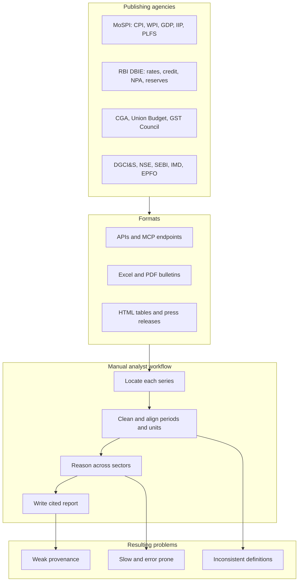
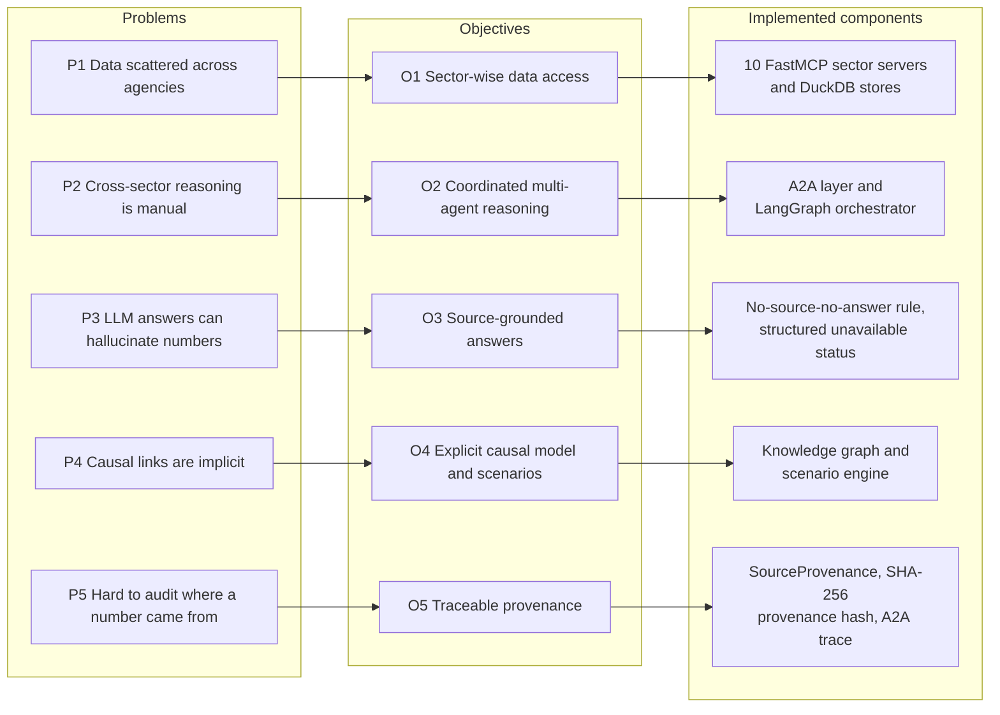
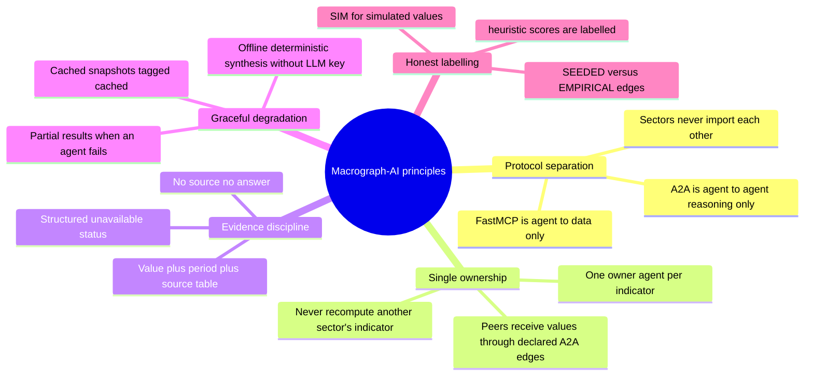
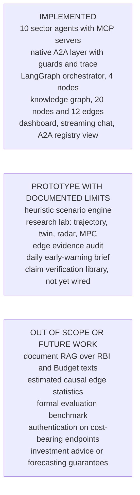
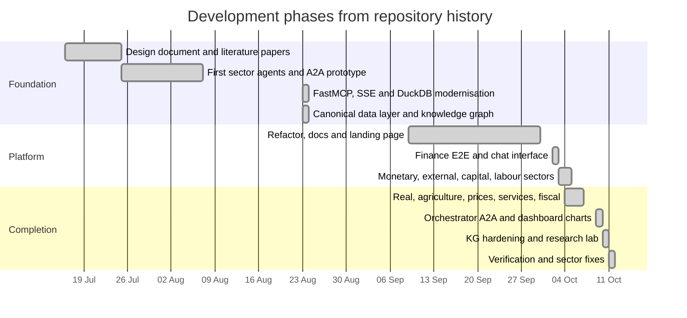
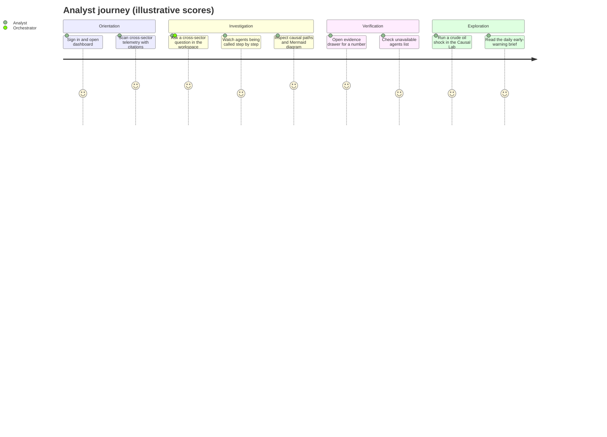

# Chapter 1: Introduction - Figures

Chapter 1 should motivate the problem, state the objectives and scope, and present the working principles. Every diagram below is accurate to the code as of 2026-10-12. Render notes, caption style and the insertion procedure are in [README.md](README.md).

---

## Figure 1.1: Fragmented landscape of Indian macroeconomic data

<!-- fig: 1.1 fragmented-data-landscape -->

- **Caption:** Figure 1.1: Official Indian macroeconomic data is published by many agencies in different formats and cadences.
- **Use in:** 1.1 Introduction / Motivation.
- **Description:** Left side shows the publishing agencies (MoSPI, RBI, CGA and Union Budget, GST Council, DGCI&S, NSE and market feeds, IMD and agriculture ministries, EPFO). The middle shows the formats an analyst meets (APIs, Excel and PDF bulletins, web tables, press releases). The right shows the manual steps and the resulting problems. The message: the cost of cross-sector questions is integration, not access.

---

## Figure 1.2: Problem, objectives and solution mapping

<!-- fig: 1.2 problem-objective-solution -->

- **Caption:** Figure 1.2: Mapping of identified problems to project objectives and the implemented components.
- **Use in:** 1.3 Problem Statement and 1.4 Objectives.
- **Description:** A three-column traceability diagram. Each problem has one objective and each objective maps to concrete modules in the repository, so the examiner can check that every objective is delivered.

---

## Figure 1.3: Design principles of Macrograph-AI

<!-- fig: 1.3 design-principles -->

- **Caption:** Figure 1.3: Core design principles that govern every module of the platform.
- **Use in:** 1.5 Scope / Design principles (or start of Chapter 3).
- **Description:** A mind map with the project at the centre and five branches: protocol separation, single ownership, evidence discipline, graceful degradation and honest labelling. Each leaf is a rule that is enforced in code or tests.

---

## Figure 1.4: Scope of the project (implemented versus not implemented)

<!-- fig: 1.4 project-scope -->

- **Caption:** Figure 1.4: Project scope: implemented capabilities, prototypes and items explicitly out of scope.
- **Use in:** 1.6 Scope of the Project.
- **Description:** Three groups. Green nodes are implemented and tested; amber nodes are prototypes whose limits are documented; grey nodes are out of scope or future work. Stating the grey group openly avoids over-claiming in the viva.

---

## Figure 1.5: Project development timeline

<!-- fig: 1.5 development-timeline -->

- **Caption:** Figure 1.5: Development timeline derived from the repository history (16 July to 11 October 2026).
- **Use in:** 1.7 Project plan / Methodology of work.
- **Description:** A Gantt chart built from commit dates. Replace the phase names with your own milestone names if your guide expects different wording; the dates are real commit dates.

---

## Figure 1.6: Illustrative user journey

<!-- fig: 1.6 user-journey -->

- **Caption:** Figure 1.6: Typical analyst journey with Macrograph-AI.
- **Use in:** 1.1 or Chapter 3 (user perspective).
- **Description:** Satisfaction scores (1 to 5) are illustrative, not measured; either remove the numbers or replace them after a user study.

