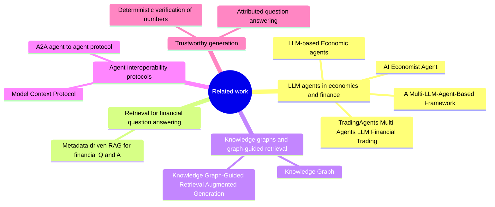
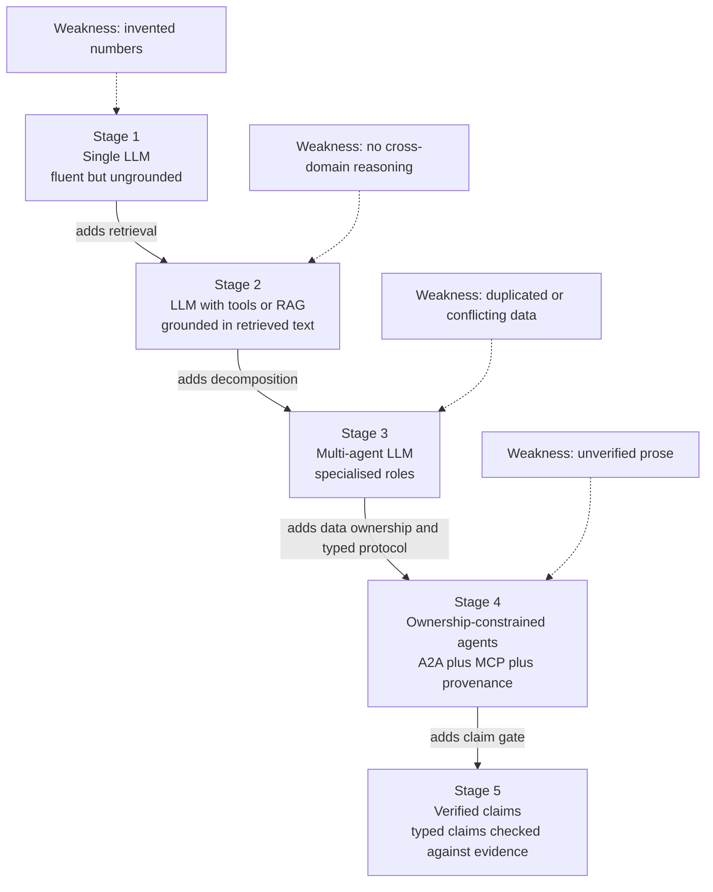
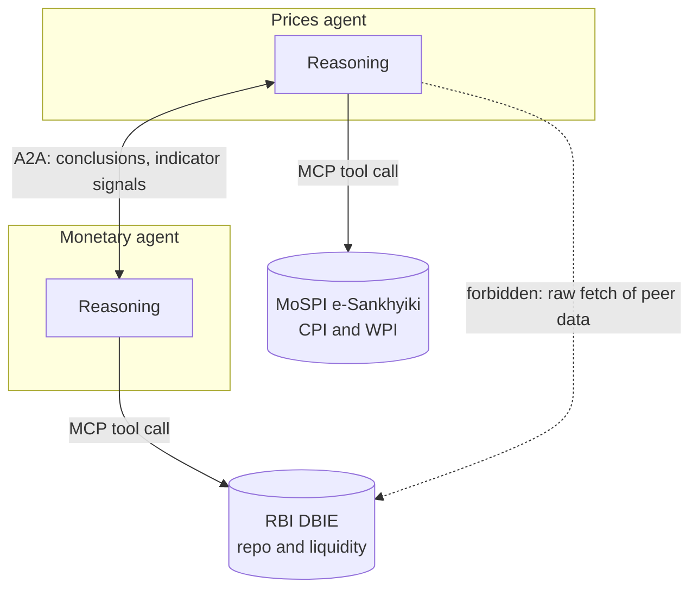
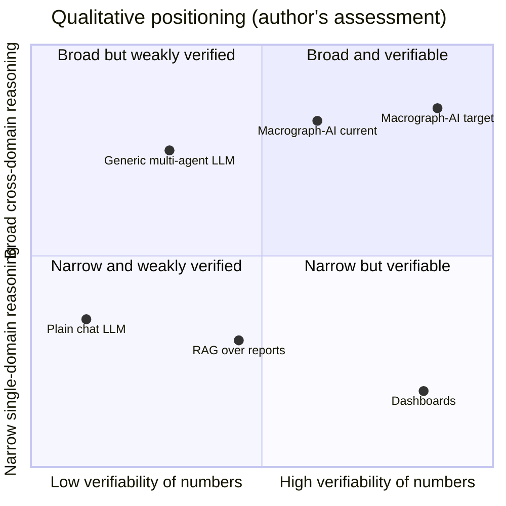
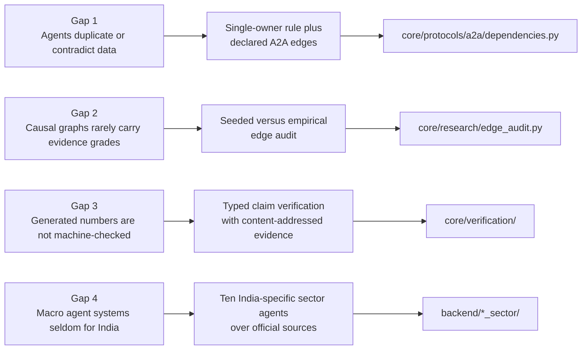
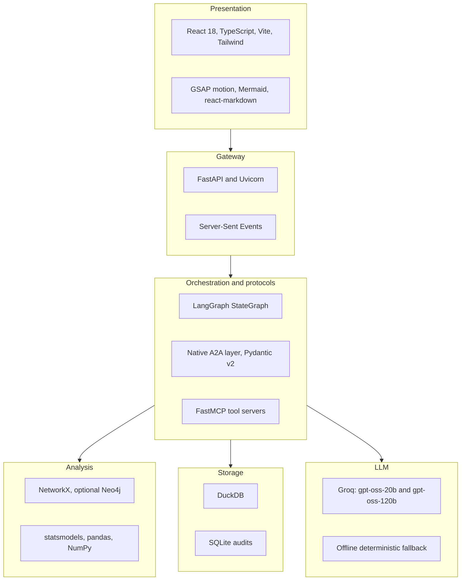

# Chapter 2: Background and Literature Survey - Figures

Chapter 2 positions the work against prior art. The seven reference papers stored in `base_papers/` are used as anchors. Do not add claims about those papers beyond what you have read in them; the diagrams below group them by theme only.

---

## Figure 2.1: Taxonomy of related work

<!-- fig: 2.1 related-work-taxonomy -->

- **Caption:** Figure 2.1: Taxonomy of the literature reviewed for this project.
- **Use in:** 2.1 Overview of the literature.
- **Description:** Five themes lead to the project. The leaf titles are the files in `base_papers/`. Add year and authors from the papers themselves when you cite them in APA format.

---

## Figure 2.2: Evolution of the approach: from single LLM to verified multi-agent system

<!-- fig: 2.2 approach-evolution -->

- **Caption:** Figure 2.2: Progression of architectures for macroeconomic question answering and where Macrograph-AI sits.
- **Use in:** 2.3 Gaps in existing work.
- **Description:** Each stage adds one capability and removes one weakness. Macrograph-AI implements stages 3 and 4 fully and stage 5 partially (verification is a library that is not yet wired into the answer path).

---

## Figure 2.3: Concept of A2A versus MCP

<!-- fig: 2.3 a2a-vs-mcp -->

- **Caption:** Figure 2.3: Separation of the agent-to-agent reasoning channel (A2A) and the agent-to-data channel (MCP).
- **Use in:** 2.4 Protocol background.
- **Description:** Two agents exchange conclusions horizontally over A2A, and each fetches raw data vertically over MCP from its own sources. The crossed-out dotted arrow is the forbidden path: an agent fetching another agent's data.

---

## Figure 2.4: Comparison of system categories

<!-- fig: 2.4 category-comparison -->

- **Caption:** Figure 2.4: Qualitative positioning of system categories by verifiability of numbers and breadth of cross-domain reasoning.
- **Use in:** 2.3 Gaps in existing work.
- **Description:** The coordinates are the author's qualitative judgement, not measurements. State this in the text. Do not present it as a result.

---

## Figure 2.5: Research gap analysis

<!-- fig: 2.5 research-gap -->

- **Caption:** Figure 2.5: Gaps identified in the literature and the corresponding contributions of this work.
- **Use in:** 2.5 Research gaps and motivation.
- **Description:** Maps each gap to the mechanism built to address it and to the evidence in the repository.

---

## Figure 2.6: Technology selection map

<!-- fig: 2.6 technology-map -->

- **Caption:** Figure 2.6: Technologies chosen for each layer and the reason for the choice.
- **Use in:** 2.6 Tools and technologies (or Chapter 3).
- **Description:** Technologies shown are those actually used in the code. PydanticAI and Qdrant are intentionally absent because they are not implemented.

