# Chapter 3: System Design and Architecture - Figures

Chapter 3 (proposed system / design) carries the largest number of figures. The first four are the ones examiners expect on every project: context, layered architecture, deployment and data model.

---

## Figure 3.1: System context diagram

<!-- fig: 3.1 system-context -->

- **Caption:** Figure 3.1: System context of Macrograph-AI showing users, external data sources and external services.
- **Use in:** 3.1 Overall system overview.
- **Description:** The platform is one system boundary. Analysts reach it through a browser; it consumes official data sources through MCP servers and web APIs, calls an LLM provider for narrative reasoning, optionally mirrors the knowledge graph to Neo4j, and uses Google Identity Services for sign-in.

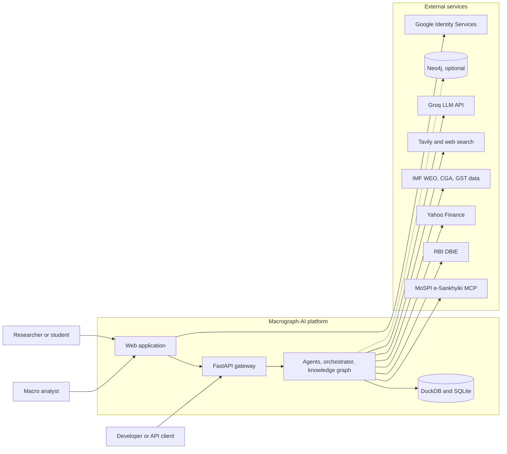

---

## Figure 3.2: Layered architecture

<!-- fig: 3.2 layered-architecture -->

- **Caption:** Figure 3.2: Layered architecture of Macrograph-AI.
- **Use in:** 3.2 System architecture. This is the main architecture figure; put it on its own page.
- **Description:** Seven layers from presentation to storage. Arrows only point downward, which is the dependency rule: upper layers call lower layers and never the reverse. The sector agents sit side by side inside the agent layer and are connected only through the protocol layer.

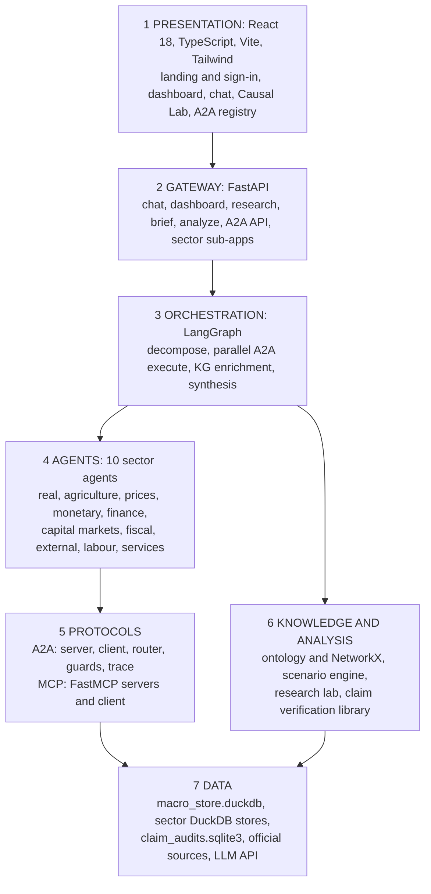

---

## Figure 3.3: Runtime deployment view

<!-- fig: 3.3 deployment-view -->

- **Caption:** Figure 3.3: Runtime deployment view of the development configuration.
- **Use in:** 3.7 Deployment / Implementation environment.
- **Description:** All sector agents run inside a single FastAPI process and talk through an in-process A2A transport; replacing the transport with HTTP is possible without changing callers. The Vite dev server proxies API calls to the gateway on port 8000. DuckDB files are local; Neo4j is optional.

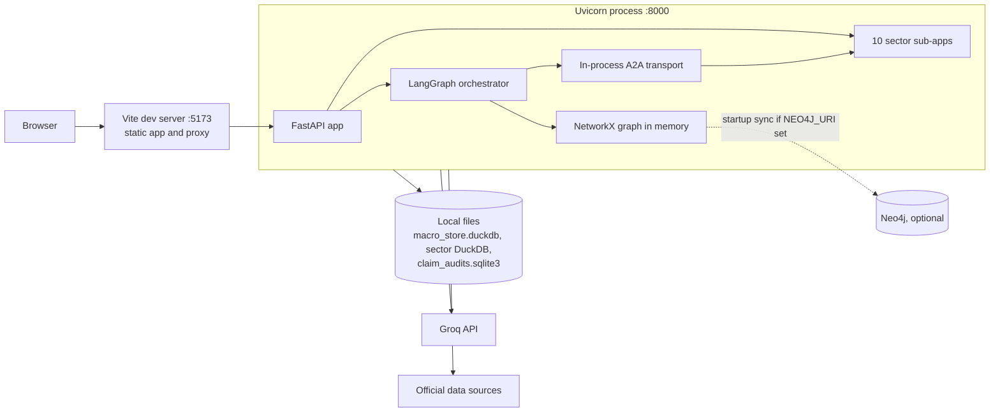

---

## Figure 3.4: Package dependency rules

<!-- fig: 3.4 package-dependencies -->

- **Caption:** Figure 3.4: Allowed import directions between packages.
- **Use in:** 3.3 Design constraints / modularity.
- **Description:** Sector packages may import `core` but never each other. The only module in `core` that names sector packages is `registry_bootstrap.py`, which registers each sector's agent card and executor. Cross-sector data moves via A2A messages at run time instead of imports.

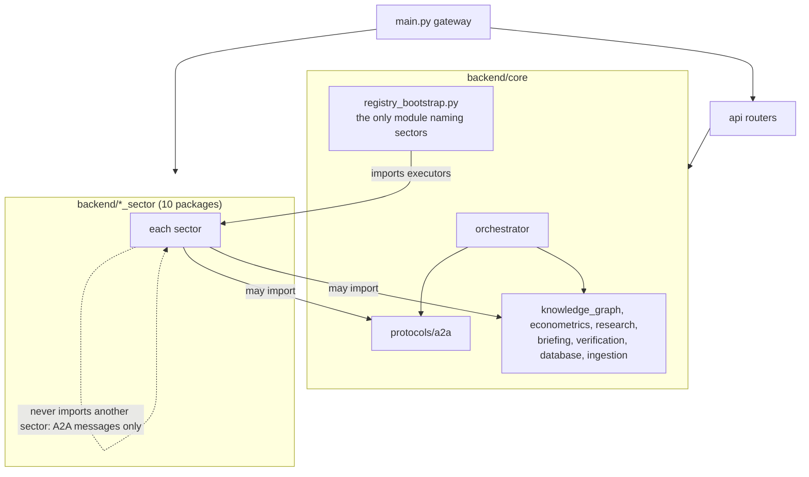

---

## Figure 3.5: Use case diagram

<!-- fig: 3.5 use-cases -->

- **Caption:** Figure 3.5: Use cases for the principal actors.
- **Use in:** 3.4 Functional requirements.
- **Description:** Three actors and the use cases each can trigger. Convert to formal UML ovals in draw.io if your guide requires UML notation.

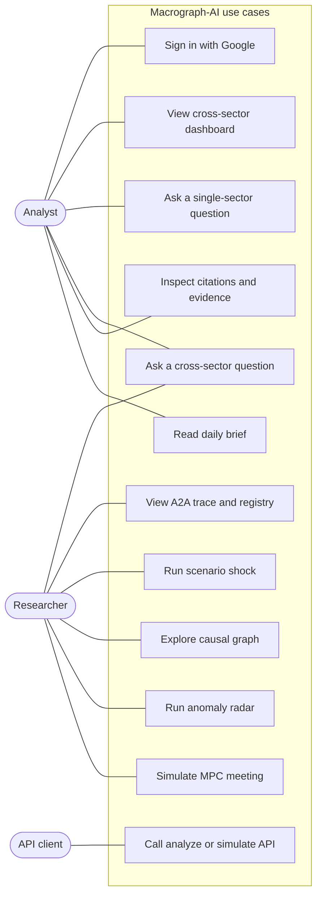

---

## Figure 3.6: Internal structure of a sector agent package

<!-- fig: 3.6 sector-package-structure -->

- **Caption:** Figure 3.6: Standard internal structure of a sector agent package.
- **Use in:** 3.5 Sector agent design.
- **Description:** Every sector follows the same shape (some are partial, see the maturity table in `docs/status-and-roadmap.md`). The MCP server is the only door to data; the agent node reasons over the data; the executor exposes the agent to A2A; the sub-app exposes HTTP.

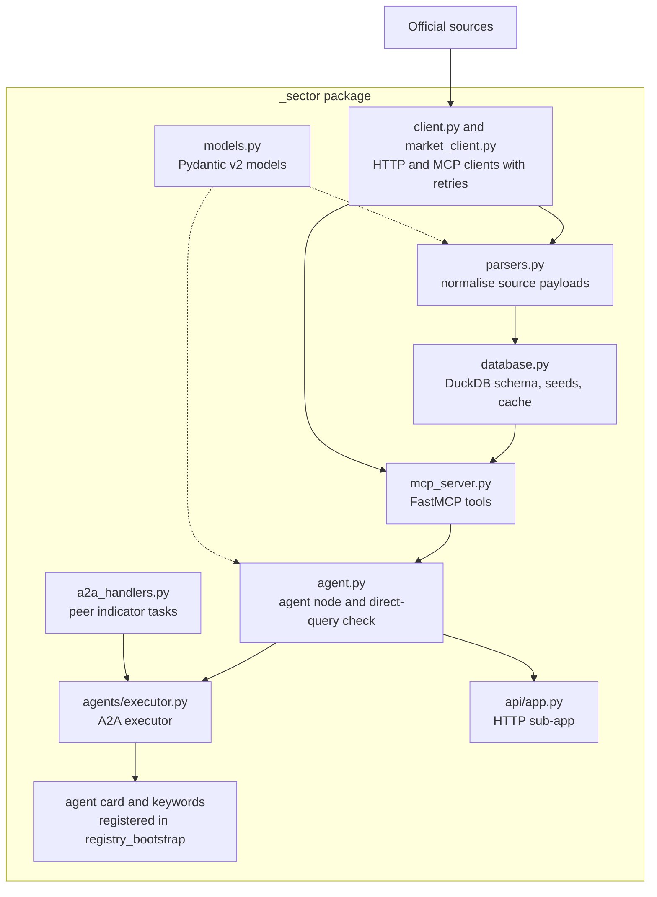

---

## Figure 3.7: Indicator ownership and declared A2A dependencies

<!-- fig: 3.7 ownership-dependencies -->

- **Caption:** Figure 3.7: Ten sector agents and the seven declared sector-to-sector A2A dependencies.
- **Use in:** 3.5 or 4.x (single source of truth).
- **Description:** Each box is an owner of its indicators. Arrows go from the consumer to the provider and are labelled by the A2A task. The orchestrator (not drawn) may call every agent; every other pair is refused with `DEPENDENCY_NOT_ALLOWED`.

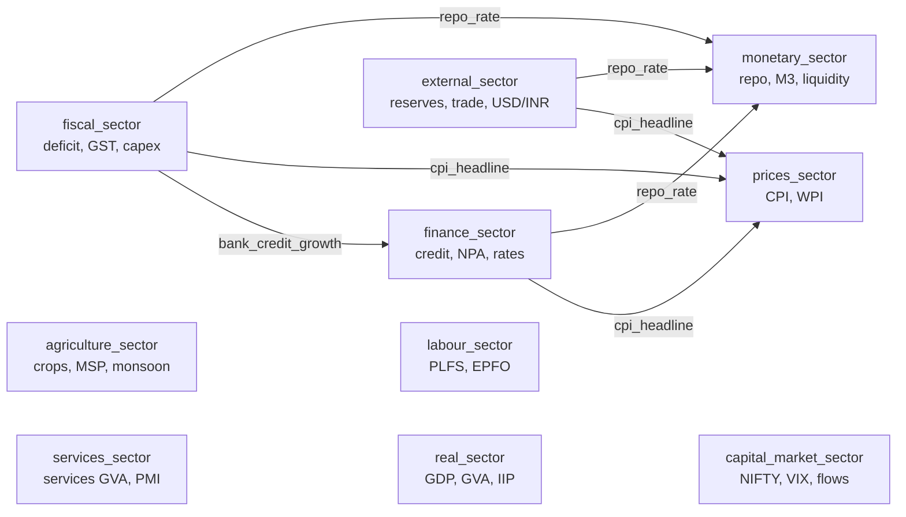

---

## Figure 3.8: Canonical data model

<!-- fig: 3.8 canonical-data-model -->

- **Caption:** Figure 3.8: Entity-relationship diagram of the canonical economic data layer.
- **Use in:** 3.6 Database design.
- **Description:** `CanonicalIndicator` is the registry of what can be measured, `CanonicalObservation` is one measured value with provenance, `CausalRelationship` links two indicators, and `ScenarioResult` records a simulation with the relationship ids it used. These are the Pydantic models in `core/data/schema.py` and the tables `canonical_indicators` and `canonical_observations` in `macro_store.duckdb`.

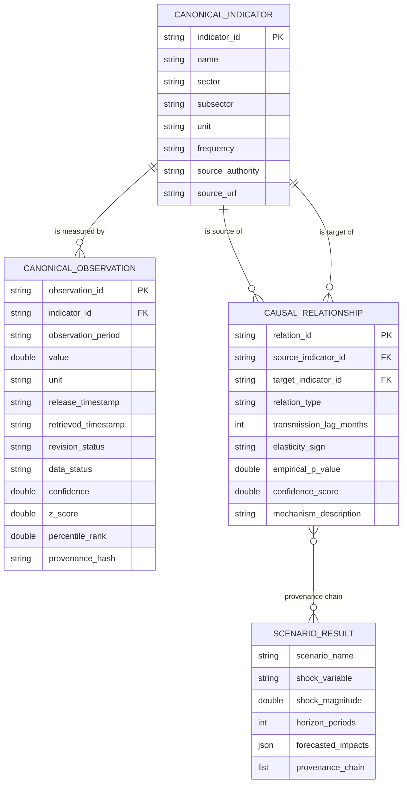

---

## Figure 3.9: Class diagram of the A2A message model

<!-- fig: 3.9 a2a-class-diagram -->

- **Caption:** Figure 3.9: Class diagram of the A2A request, response and provenance models.
- **Use in:** 3.8 Protocol design (or Chapter 4).
- **Description:** Strict Pydantic v2 models that forbid extra fields. `A2ARequest` carries the loop-protection fields (`depth`, `call_chain`, `parent_request_id`). `A2AResponse` must carry `SourceProvenance` records unless it failed.

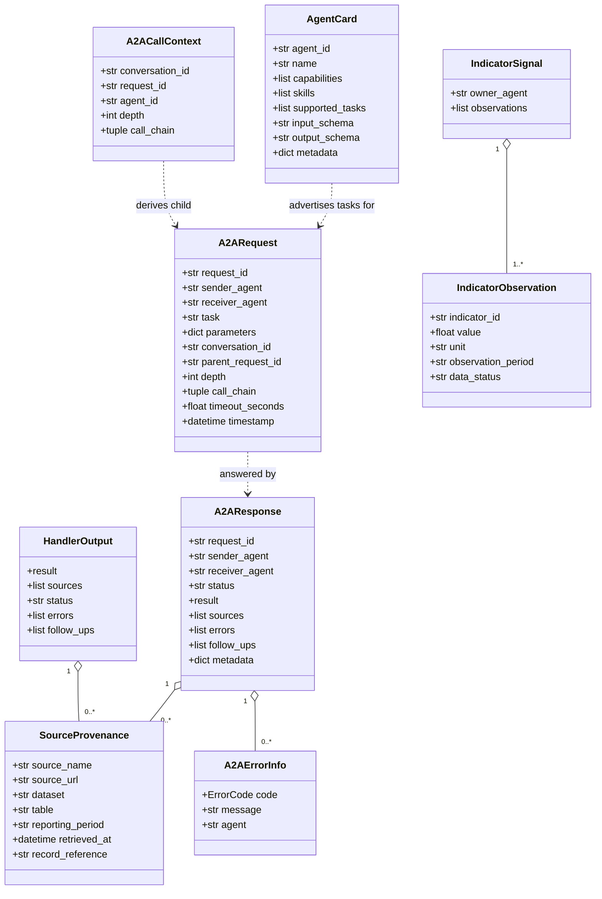

---

## Figure 3.10: Class diagram of knowledge-graph and scenario components

<!-- fig: 3.10 kg-class-diagram -->

- **Caption:** Figure 3.10: Principal classes of the knowledge graph, scenario engine and optional Neo4j store.
- **Use in:** 3.9 Knowledge graph design (or Chapter 6).
- **Description:** The ontology owns indicators and relationships and validates them. The NetworkX engine builds the in-memory graph and answers path and impact queries. The causal engine uses the graph to simulate shocks. The Neo4j store mirrors the ontology and is optional.

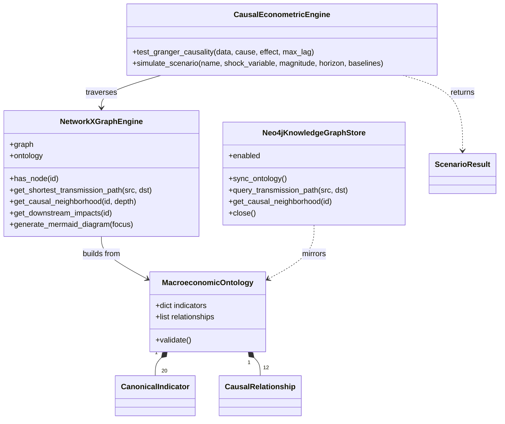

---

## Figure 3.11: Configuration and API-key topology

<!-- fig: 3.11 configuration-topology -->

- **Caption:** Figure 3.11: Configuration sources and the six-key LLM credential convention.
- **Use in:** 3.7 Implementation environment.
- **Description:** `PlatformSettings` reads `backend/.env`. Each of the six Groq keys is shared by a pair of sectors to spread rate limits; the orchestrator has its own key. If no key resolves, every LLM call returns the unavailable notice and the deterministic fallback is used.

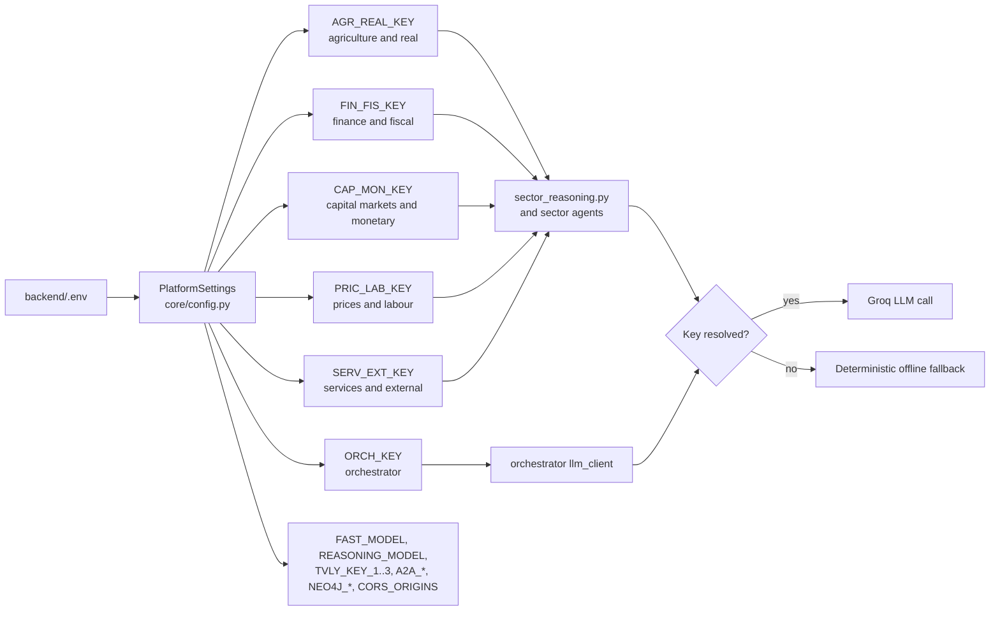
