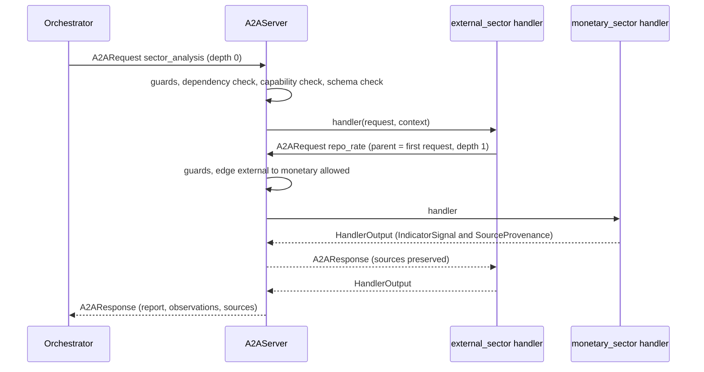
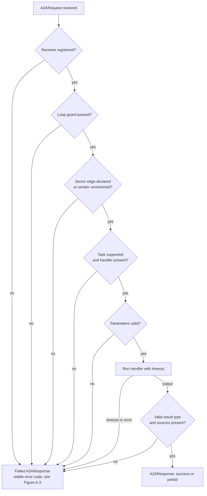
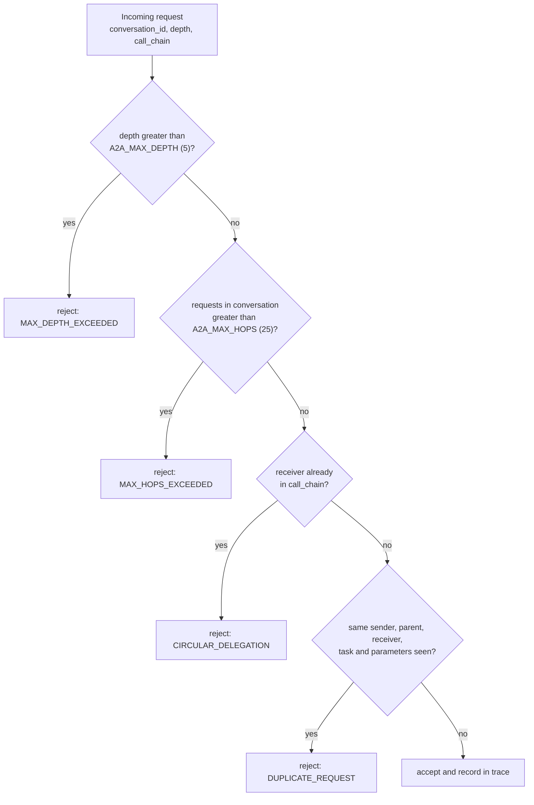
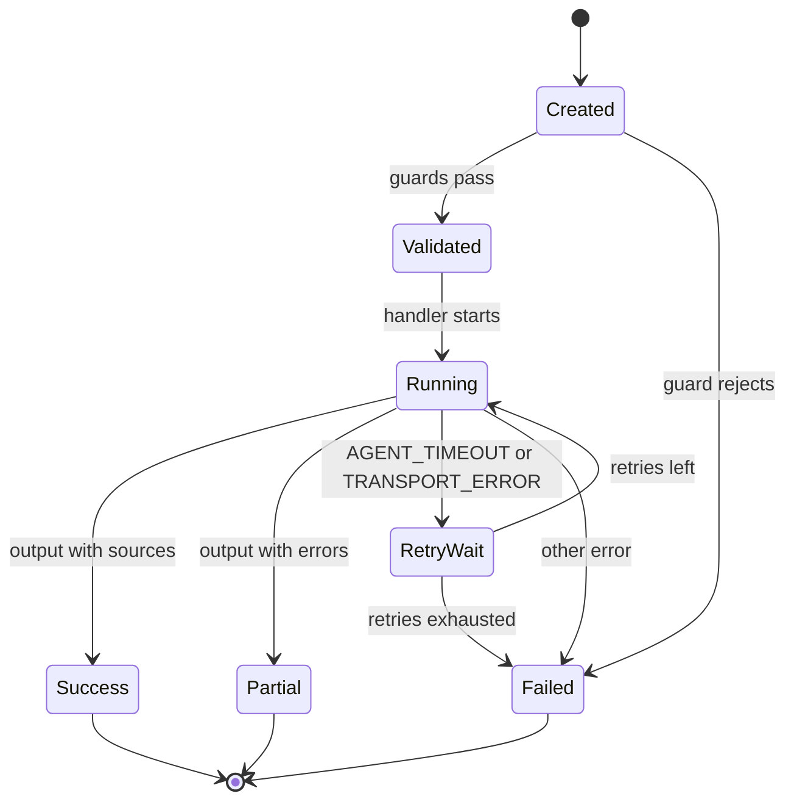
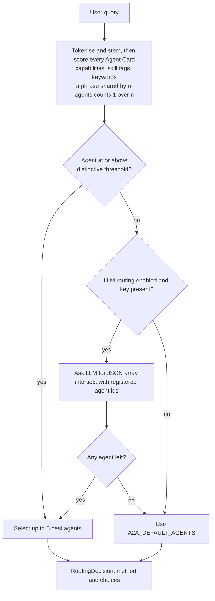
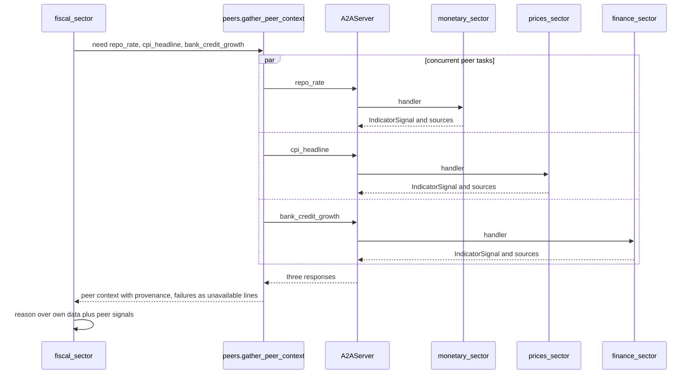
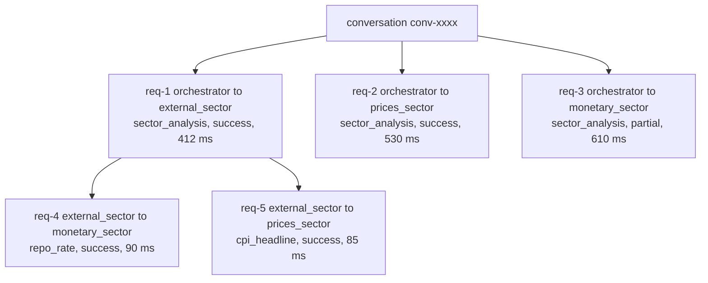
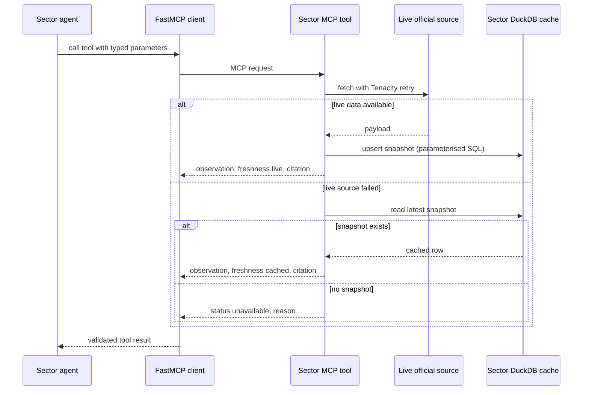
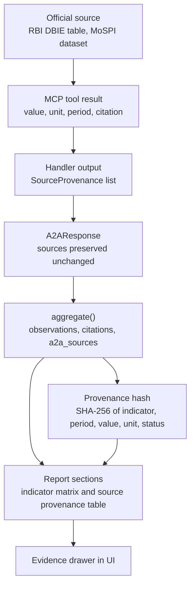
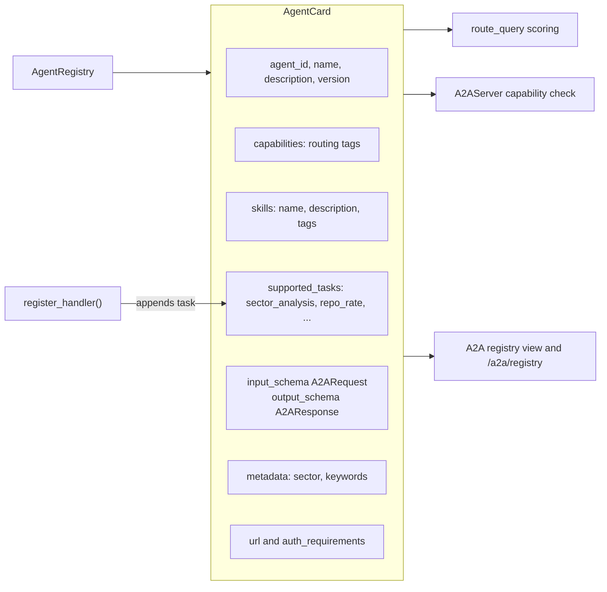

# Chapter 4: Protocol Design (A2A and MCP) - Figures

These figures explain how agents talk to each other and to data. They are derived from `backend/core/protocols/a2a`, `docs/a2a-architecture.md` and the sector MCP servers.

---

## Figure 4.1: A2A request handling with nested peer call

<!-- fig: 4.1 a2a-sequence -->

- **Caption:** Figure 4.1: Sequence of an A2A delegation in which a sector agent requests a peer indicator.
- **Use in:** 4.1 Agent-to-agent communication.
- **Description:** The orchestrator sends `sector_analysis` to the external-sector agent. While loading its own data, that agent asks the monetary agent for the repo rate. The server enforces guards on both hops and sources travel unchanged back to the orchestrator.

---

## Figure 4.2: A2AServer validation pipeline

<!-- fig: 4.2 a2a-server-pipeline -->

- **Caption:** Figure 4.2: Validation pipeline applied by the A2A server to every request.
- **Use in:** 4.2 Protocol enforcement.
- **Description:** Each diamond is a guard that returns a structured failure response (never an exception across agents) with a stable error code. Only a request that passes all guards reaches the handler. A non-failed response without sources is rejected, which enforces "No Source, No Answer" at protocol level.

---

## Figure 4.3: Loop-protection safeguards

<!-- fig: 4.3 loop-protection -->

- **Caption:** Figure 4.3: Loop and runaway-delegation protection in the A2A layer.
- **Use in:** 4.3 Safety and reliability.
- **Description:** Four checks run before any handler. Limits come from settings: depth 5, 25 requests per conversation, 90 s request timeout and 25 s peer timeout by default.

---

## Figure 4.4: Life cycle of an A2A request

<!-- fig: 4.4 request-lifecycle -->

- **Caption:** Figure 4.4: State diagram of an A2A request including retry of retryable failures.
- **Use in:** 4.3 Reliability.
- **Description:** Only `AGENT_TIMEOUT` and `TRANSPORT_ERROR` are retried (exponential backoff, same `request_id`). The orchestrator sends full analyses with zero retries because they are expensive.

---

## Figure 4.5: Query routing over Agent Cards

<!-- fig: 4.5 query-routing -->

- **Caption:** Figure 4.5: Capability-based routing of a user query to sector agents.
- **Use in:** 4.4 Agent discovery and routing.
- **Description:** The query is tokenised and matched against each card's capabilities, skill tags and keywords. A phrase advertised by several agents is divided by the number advertising it, so a shared word such as "rbi" does not pull in unrelated sectors. The LLM is only a fallback and its answer is intersected with registered agent ids.

---

## Figure 4.6: Peer indicator exchange (finance and fiscal example)

<!-- fig: 4.6 peer-exchange -->

- **Caption:** Figure 4.6: A sector agent obtaining peer indicators through A2A while preparing its own analysis.
- **Use in:** 4.5 Cross-sector collaboration.
- **Description:** The fiscal agent needs repo rate, CPI and bank credit growth. It never calls those sectors' code or databases. It asks through `gather_peer_context`, receives `IndicatorSignal` objects with provenance, and degrades to an "unavailable" line if a peer fails.

---

## Figure 4.7: Conversation trace tree

<!-- fig: 4.7 trace-tree -->

- **Caption:** Figure 4.7: Example delegation tree reconstructed by the trace store for one conversation.
- **Use in:** 4.6 Traceability.
- **Description:** Every request has a parent, so the trace store can rebuild the call tree per `conversation_id` (`GET /a2a/v1/traces/{id}`). Node labels show task, status and an example duration; replace them with a screenshot of the A2A trace panel from your run for the final report.

---

## Figure 4.8: MCP tool invocation and data fallback chain

<!-- fig: 4.8 mcp-invocation -->

- **Caption:** Figure 4.8: An agent retrieving data through its own FastMCP server, with the fallback order.
- **Use in:** 4.7 Agent-to-data layer.
- **Description:** The agent calls a typed MCP tool. The tool tries the live official source; on failure it serves the sector's cached DuckDB snapshot tagged `cached`; if neither exists it returns a structured `unavailable` result. It never fabricates a number.

---

## Figure 4.9: Provenance chain from source to report

<!-- fig: 4.9 provenance-chain -->

- **Caption:** Figure 4.9: Propagation of provenance from the official source to the final report.
- **Use in:** 4.8 Provenance and citation.
- **Description:** A fact keeps its source authority, dataset, table, period and retrieval time at every stage. The final report shows a provenance table and a SHA-256-derived hash per observation, so each number can be traced back.

---

## Figure 4.10: Agent Card structure

<!-- fig: 4.10 agent-card -->

- **Caption:** Figure 4.10: Fields of an Agent Card used for discovery, routing and validation.
- **Use in:** 4.4 Agent discovery.
- **Description:** The card is both documentation and configuration. `supported_tasks` is kept in sync with the registered handlers, so the card always matches what is executable.

