# Chapter 5: Implementation of Orchestration, Sector Agents and Data Layer - Figures

---

## Figure 5.1: LangGraph orchestrator state graph

<!-- fig: 5.1 orchestrator-graph -->

- **Caption:** Figure 5.1: The four-node LangGraph orchestrator and the state keys written by each node.
- **Use in:** 5.1 Orchestrator implementation.
- **Description:** A linear graph. Each node reads and writes keys of `OrchestratorState`. The A2A node returns partial data on agent failure and the run continues.

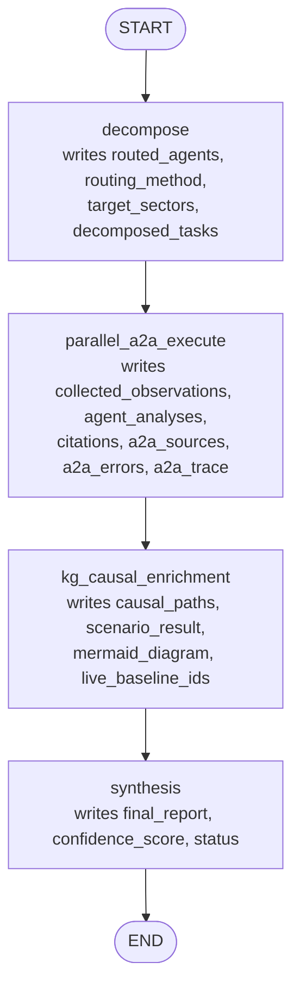

---

## Figure 5.2: End-to-end sequence for a cross-sector query

<!-- fig: 5.2 end-to-end-sequence -->

- **Caption:** Figure 5.2: End-to-end sequence of a cross-sector chat request through the platform.
- **Use in:** 5.1 Orchestrator implementation, or Appendix A as a worked example.
- **Description:** The browser opens a Server-Sent Events stream. The orchestrator graph runs; progress is streamed as `step` events read live from the trace store; the report is streamed as `token` events and the final `done` event carries citations, A2A summary, consensus and model card.

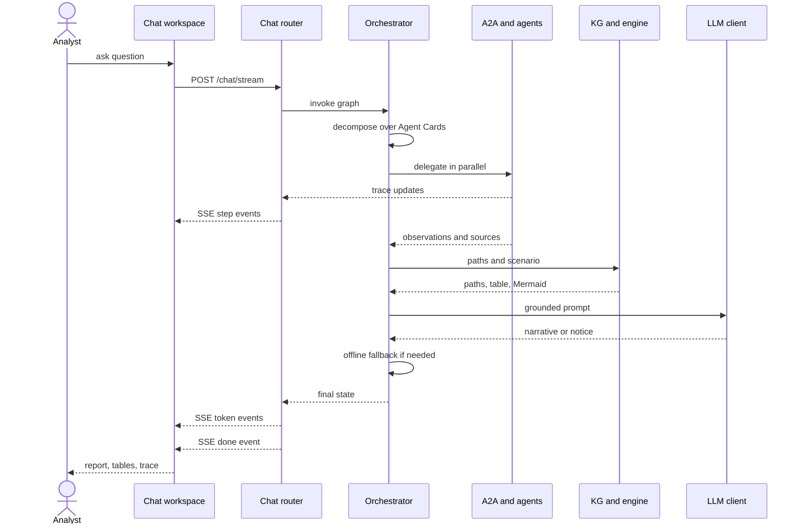

---

## Figure 5.3: Chat routing decision (direct versus orchestrated)

<!-- fig: 5.3 chat-routing -->

- **Caption:** Figure 5.3: Decision logic that sends a message to a single sector agent or to the full orchestrator.
- **Use in:** 5.2 Chat and routing implementation.
- **Description:** The UI sends the selected agent id. Direct sector chats bypass the orchestrator and call the sector's agent node. When the orchestrator is selected and the query is clearly a single-sector prices query, it is rerouted to the prices agent. Everything else uses the graph.

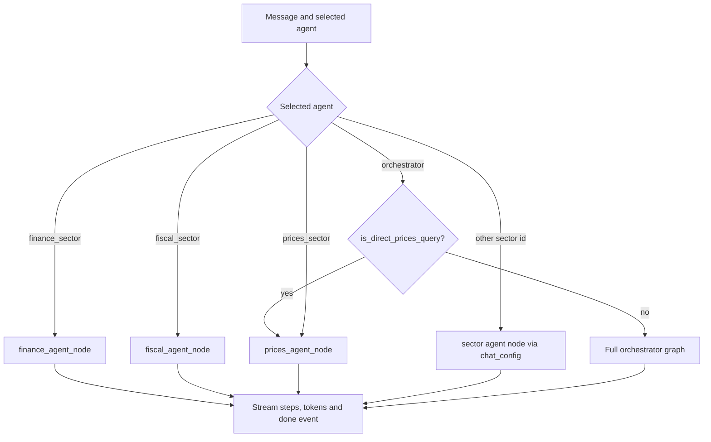

---

## Figure 5.4: Delegation, follow-up round and aggregation

<!-- fig: 5.4 delegate-aggregate -->

- **Caption:** Figure 5.4: Parallel delegation, bounded follow-up round and aggregation of A2A responses.
- **Use in:** 5.1 Orchestrator implementation.
- **Description:** Requests go out concurrently. A response may include up to three follow-ups, which are sent once as a bounded second round. Aggregation validates each response, extracts observations from JSON or markdown artifacts, and converts failures into `a2a_errors`; the run status becomes `a2a_partial` rather than failing.

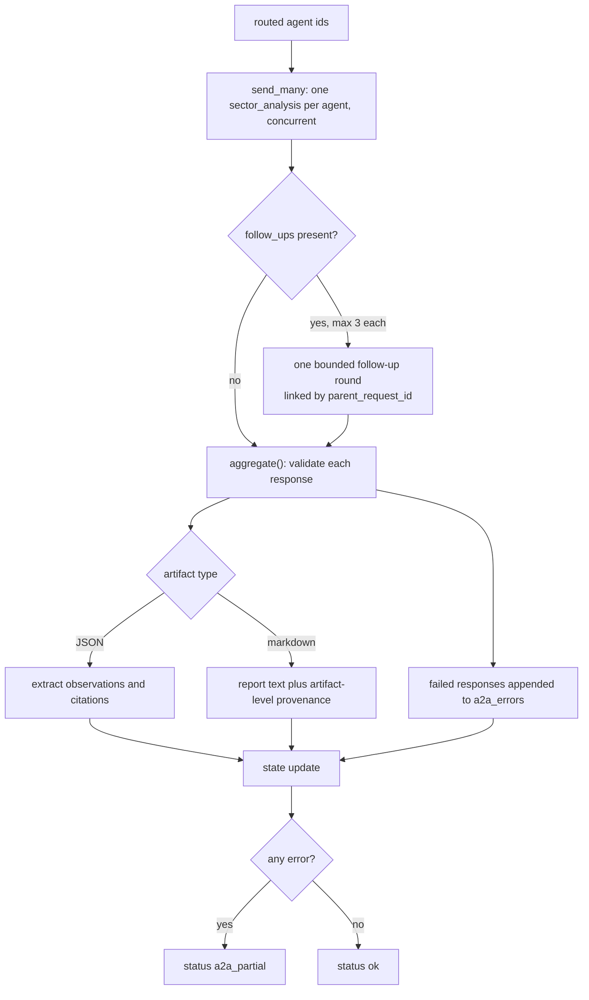

---

## Figure 5.5: Structure of the generated report

<!-- fig: 5.5 report-structure -->

- **Caption:** Figure 5.5: Sections of the cited intelligence report produced by the synthesis node.
- **Use in:** 5.3 Synthesis.
- **Description:** The narrative is only section 1. Sections 2 to 6 are assembled deterministically from structured state, so the evidence and provenance never depend on LLM prose.

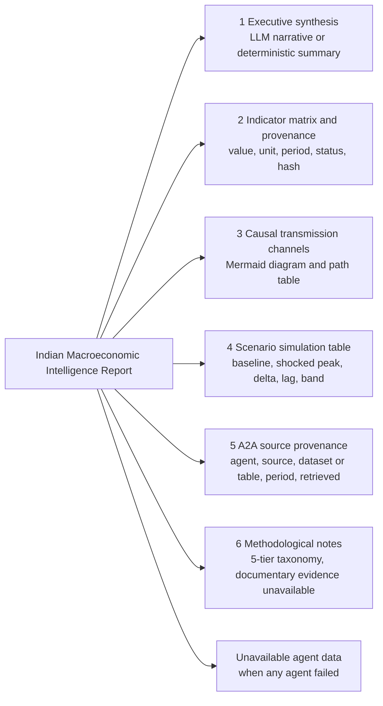

---

## Figure 5.6: LLM availability and deterministic fallback ladder

<!-- fig: 5.6 offline-fallback -->

- **Caption:** Figure 5.6: Graceful degradation when the LLM is not available.
- **Use in:** 5.4 Robustness.
- **Description:** Every LLM-using stage has a deterministic path built from the same structured evidence, so the platform works without credentials (useful for demonstrations and tests). The notice string is compared by the callers to decide when to fall back.

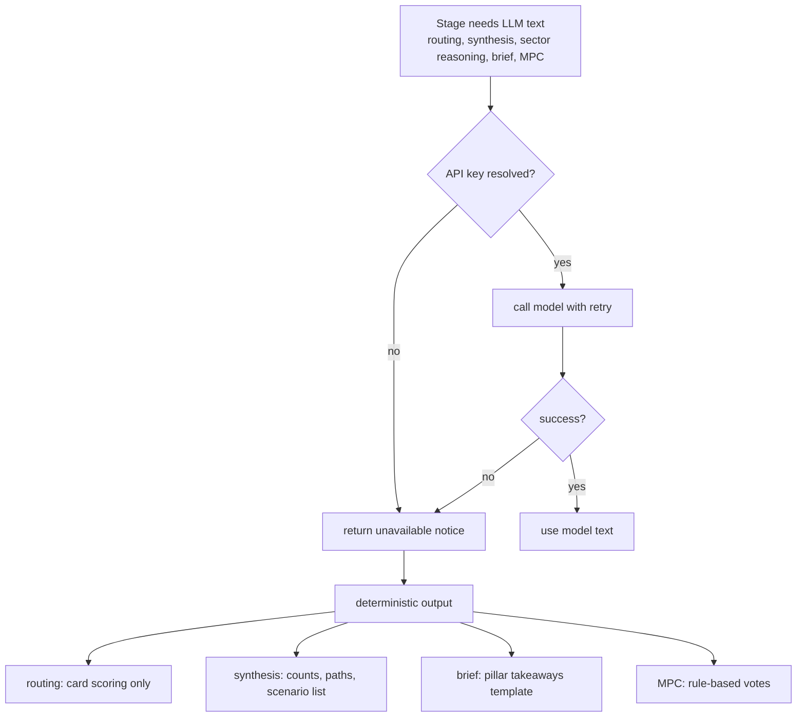

---

## Figure 5.7: Live baseline override for scenarios

<!-- fig: 5.7 live-baselines -->

- **Caption:** Figure 5.7: Selection of simulation baselines: live observations override fixed defaults.
- **Use in:** 5.5 Scenario integration.
- **Description:** For each indicator in the knowledge graph the first usable sector observation replaces the default baseline. The report states which indicators used live baselines and which used defaults, so a report cannot silently contradict the retrieved data.

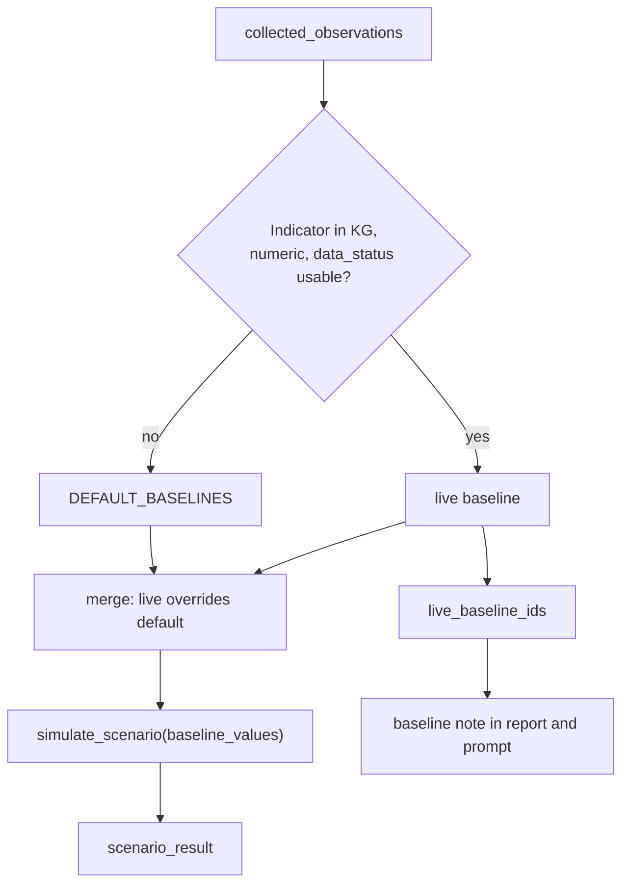

---

## Figure 5.8: Generic sector data pipeline

<!-- fig: 5.8 sector-data-pipeline -->

- **Caption:** Figure 5.8: Data acquisition pipeline shared by the sector agents.
- **Use in:** 5.6 Data acquisition.
- **Description:** Source payloads are fetched with retries, parsed into Pydantic models, validated, stored with parameterised SQL and returned with a citation and a freshness flag. The `fetch_log` table records every attempt.

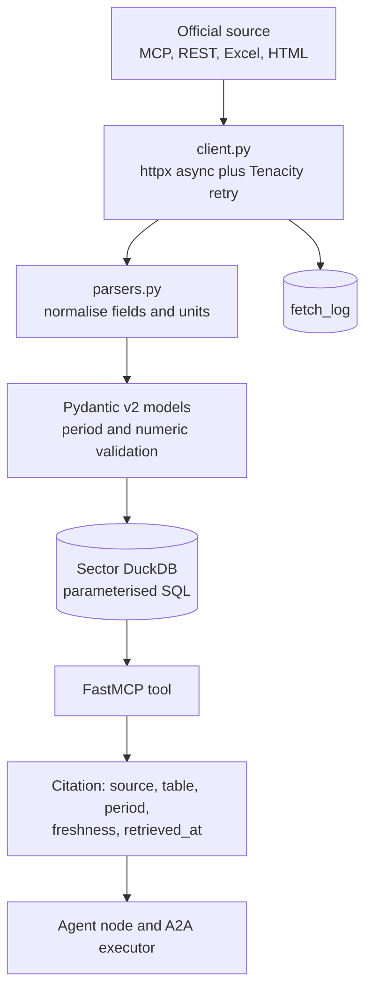

---

## Figure 5.9: Canonical ingestion pipeline

<!-- fig: 5.9 ingestion-pipeline -->

- **Caption:** Figure 5.9: Canonical ingestion pipeline of the shared core data layer.
- **Use in:** 5.6 Data acquisition.
- **Description:** Source adapters are registered by canonical indicator id. The scheduler runs adapters on demand. The validator checks numeric ranges and period formats, the normaliser maps to a `CanonicalObservation`, and the provenance step attaches the SHA-256 hash before storage in `macro_store.duckdb`.

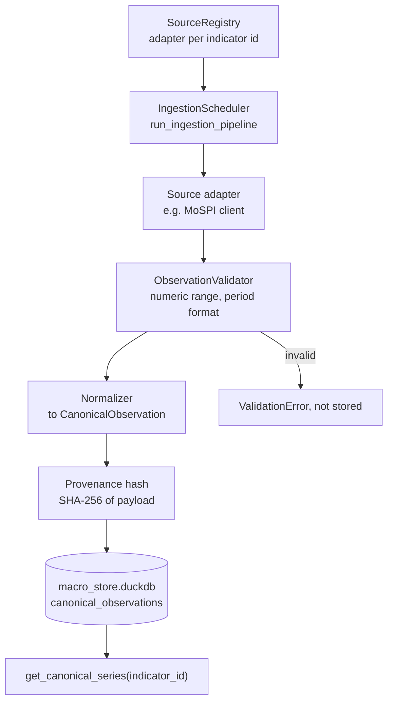

---

## Figure 5.10: Data sources by sector

<!-- fig: 5.10 data-sources-by-sector -->

- **Caption:** Figure 5.10: Primary data sources feeding each sector agent.
- **Use in:** 5.6 Data acquisition.
- **Description:** One cluster per sector. Verify the source names against the per-sector README before printing: some sectors use more than one fallback source.

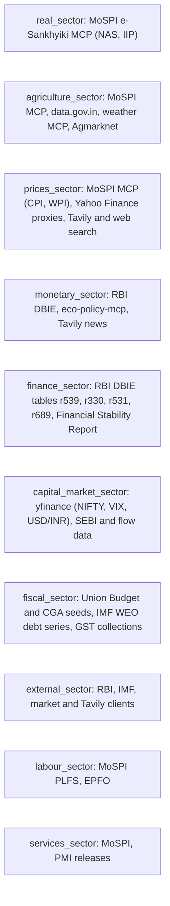

---

## Figure 5.11: Sector DuckDB tables

<!-- fig: 5.11 sector-tables -->

- **Caption:** Figure 5.11: Tables created by each sector's DuckDB schema.
- **Use in:** 5.7 Database design (tables chapter).
- **Description:** Table names are taken from the `CREATE TABLE` statements in each `database.py`. Every sector also has a `fetch_log` table. Prices and agriculture do not keep a persistent sector database in the current code.

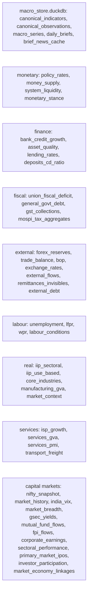

---

## Figure 5.12: Direct sector agent reasoning pipeline

<!-- fig: 5.12 direct-agent-pipeline -->

- **Caption:** Figure 5.12: Evidence-grounded reasoning pipeline of a direct sector agent (Prices and Finance pattern).
- **Use in:** 5.8 Sector agent reasoning.
- **Description:** Official observations come first through the sector's own MCP tools. Market proxies and news are fetched concurrently as context, not as authoritative data. The LLM receives the consolidated dataset and must cite periods and sources; the response keeps the citations separate from prose.

```mermaid
flowchart TB
    Q["User query"] --> D{"Query in sector domain?"}
    D -->|"no"| DECL["Politely decline and suggest correct agent"]
    D -->|"yes"| SEL["Select services and MCP tools"]
    SEL --> PAR{"concurrent"}
    PAR --> OFF["Official observations via own MCP tools"]
    PAR --> MKT["Market proxies, e.g. crude, gold, USD/INR, NIFTY"]
    PAR --> NEWS["Tavily news and web research"]
    PAR --> PEER["Peer indicators via A2A (finance, fiscal)"]
    OFF --> CONS["Consolidated dataset"]
    MKT --> CONS
    NEWS --> CONS
    PEER --> CONS
    CONS --> RSN["reason_over_sector_data<br/>core/sector_reasoning.py"]
    RSN --> RES["Report plus data_context plus citations plus freshness"]
```

---

## Figure 5.13: Resilience pattern for external calls

<!-- fig: 5.13 resilience -->

- **Caption:** Figure 5.13: Retry, timeout and degradation pattern applied to external calls.
- **Use in:** 5.9 Reliability engineering.
- **Description:** Exponential backoff via Tenacity on external calls, per-request timeouts in the A2A layer, partial results instead of failures at the orchestrator, and an explicit unavailable list in the report. Nothing is silently dropped.

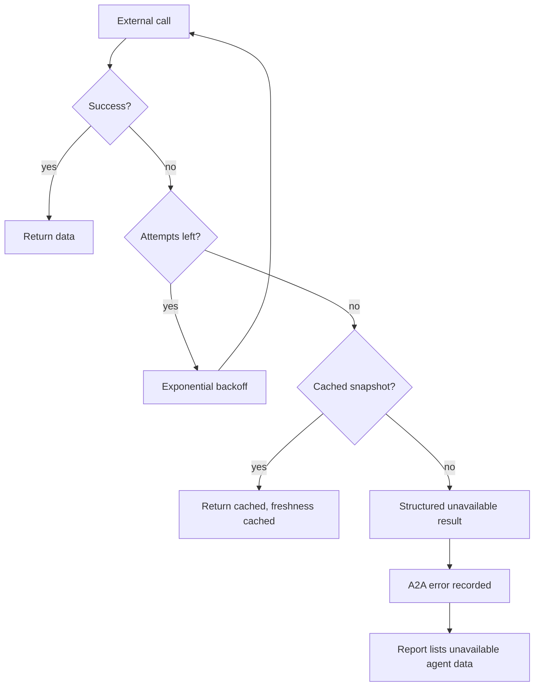
