# Chapter 6: Causal Knowledge Graph and Scenario Engine - Figures

Numbers in this chapter come from the ontology in `backend/core/knowledge_graph/ontology.py` and from a real run of `simulate_scenario` on 2026-10-12 (Brent +20 USD per barrel, default baselines). Re-run the engine before final submission if the ontology changes.

---

## Figure 6.1: The causal knowledge graph (20 indicators, 12 edges)

<!-- fig: 6.1 knowledge-graph -->

- **Caption:** Figure 6.1: Causal transmission graph of 20 canonical indicators connected by 12 typed edges. Edge labels show lag in months and elasticity sign.
- **Use in:** 6.1 Ontology design. The most important figure of this chapter; use a full page in landscape.
- **Description:** Nodes are grouped by sector. Five indicators are currently isolated (NIFTY 50, India VIX, forex reserves, debt-to-GDP and EPFO additions); they are valid nodes without edges and appear at the bottom. Note: the `trade_balance -> usd_inr` sign is flagged in the code for review, and the edge statistics are curated priors (see Chapter 9 limitations).

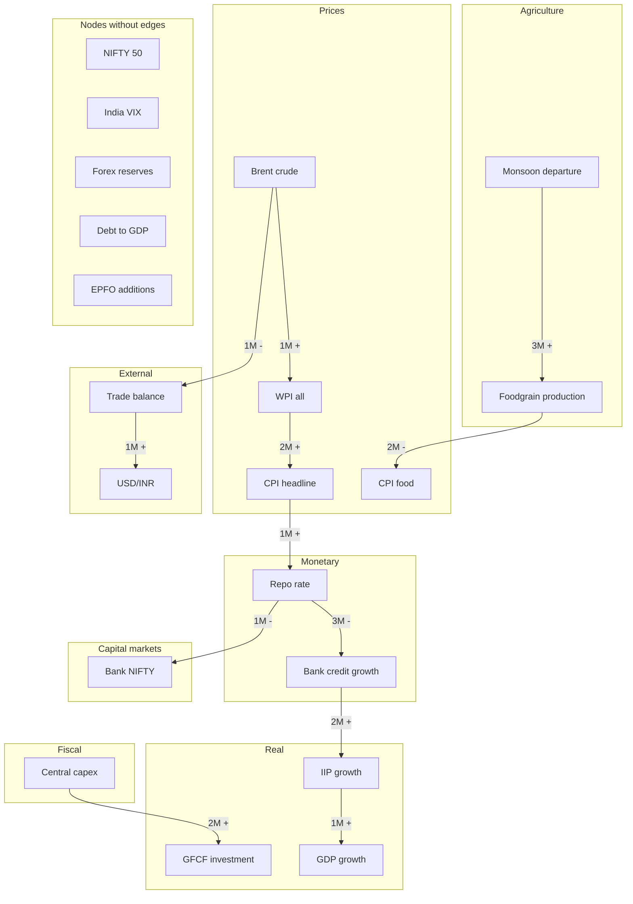

---

## Figure 6.2: Five-tier causal evidence taxonomy

<!-- fig: 6.2 causal-taxonomy -->

- **Caption:** Figure 6.2: Five-tier classification of causal relationship strength used for knowledge-graph edges.
- **Use in:** 6.2 Edge classification.
- **Description:** Tiers rise from qualitative theory to an identified structural model. Edge counts in the current ontology are in brackets: THEORY 3, STATISTICAL_ASSOCIATION 3, LAGGED_RELATIONSHIP 2, GRANGER_PREDICTIVE 2, STRUCTURAL_CAUSAL_MODEL 2. The tier is currently assigned by hand; the edge audit tests it empirically.

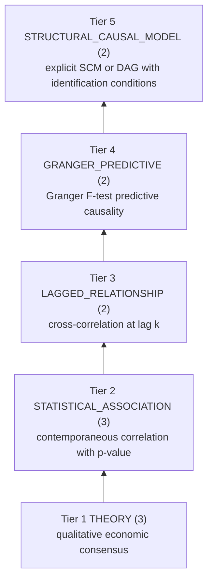

---

## Figure 6.3: Anatomy of a causal edge and validation rules

<!-- fig: 6.3 edge-anatomy -->

- **Caption:** Figure 6.3: Fields of a causal relationship and the validation rules enforced when the ontology loads.
- **Use in:** 6.2 Edge classification / 6.3 Validation.
- **Description:** Relation ids are deterministic (uuid5 of source, target and type) so provenance and Neo4j merge keys survive restarts. Invalid edges stop the application from building the graph.

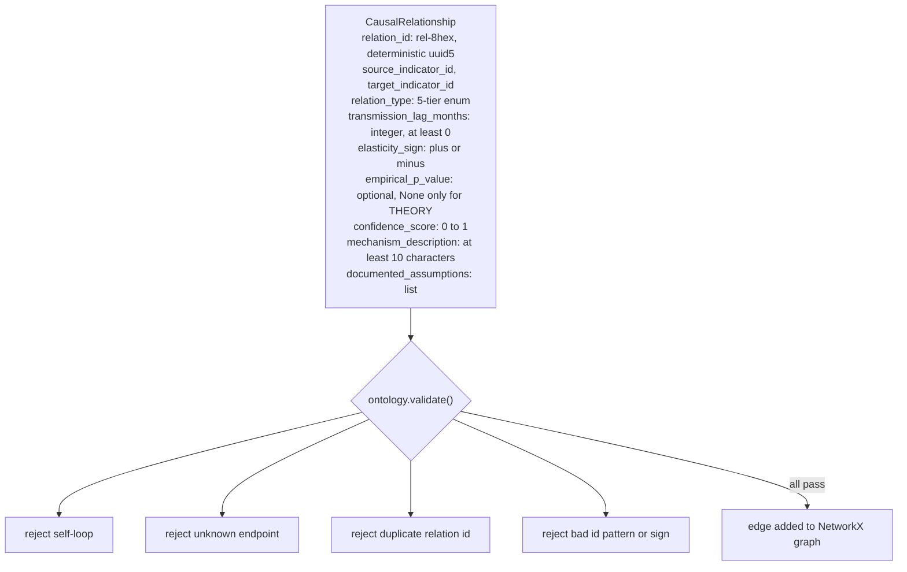

---

## Figure 6.4: Path and downstream-impact queries

<!-- fig: 6.4 graph-queries -->

- **Caption:** Figure 6.4: Algorithms for shortest transmission path and downstream impact enumeration.
- **Use in:** 6.4 Graph queries.
- **Description:** Shortest path is by hop count. If two parallel edges exist between a pair, the highest-confidence edge is used. Impacts are all descendants of the shocked node, each with hop count, summed lag and the product of edge confidences; results are sorted by hops, then by confidence.

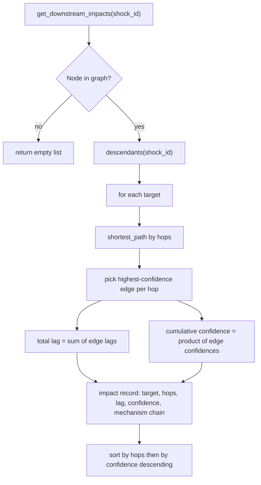

---

## Figure 6.5: Scenario propagation algorithm

<!-- fig: 6.5 scenario-algorithm -->

- **Caption:** Figure 6.5: Graph-attenuation scenario algorithm.
- **Use in:** 6.5 Scenario simulation.
- **Description:** For each downstream target, the multiplier is the product over hops of sign x 0.55 x confidence; the delta is shock x multiplier x 0.15. The band is plus or minus 25% of the delta. This is a transparent heuristic, not an econometric impulse response; label it as such in the report.

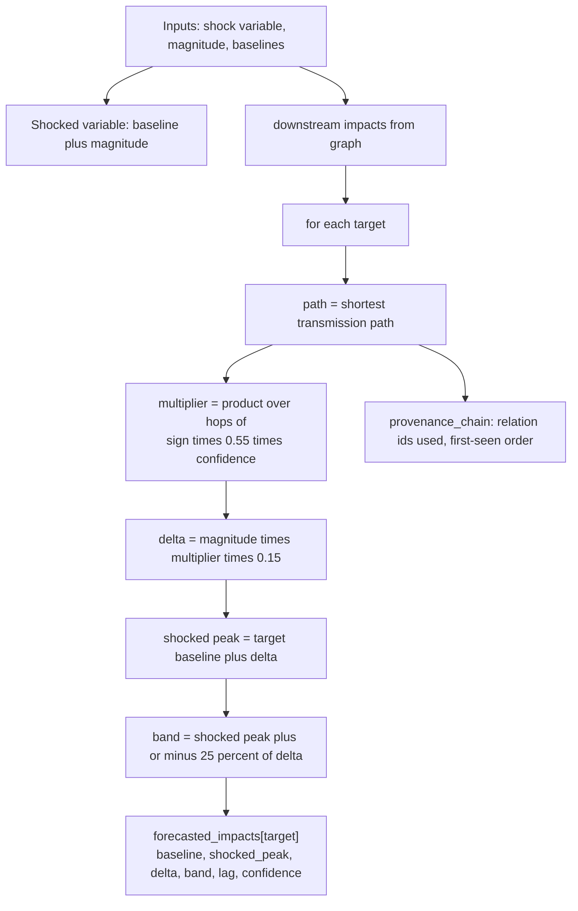

---

## Figure 6.6: Worked example: Brent +20 USD per barrel

<!-- fig: 6.6 worked-example -->

- **Caption:** Figure 6.6: Simulated transmission of a USD 20 per barrel Brent crude increase (default baselines).
- **Use in:** 6.6 Case study.
- **Description:** Values are the engine's actual output. Example check, first hop: 20 x (0.55 x 0.95) x 0.15 = 1.57 added to the WPI baseline 2.45 gives 4.02. Report honestly that USD/INR falls in this run: that is a consequence of the `+` sign on `trade_balance -> usd_inr`, which the code flags as under review. Fix the sign and re-run before submission, or discuss it as a known limitation.

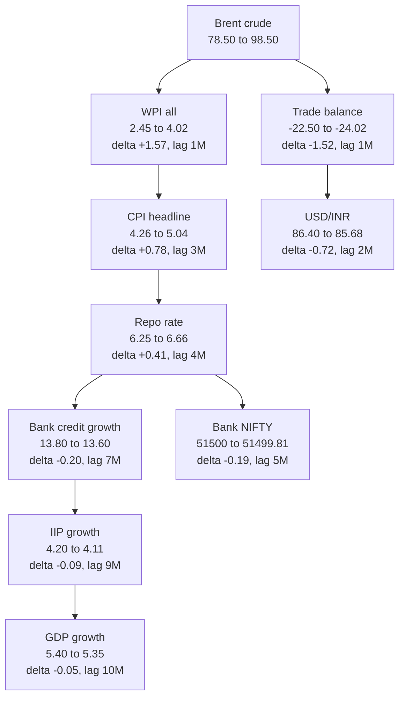

---

## Figure 6.7: Impact of the shock by transmission lag (chart)

<!-- fig: 6.7 impact-chart -->

- **Caption:** Figure 6.7: Simulated deltas of selected indicators by cumulative transmission lag (Brent +20).
- **Use in:** 6.6 Case study (results).
- **Description:** A bar chart of the deltas from Figure 6.6, ordered by lag. The units differ by indicator (percentage points or index points), so the chart conveys pattern, not comparable magnitude. State that under the figure. The engine is unit-blind; the Chapter 9 limitations discuss this.

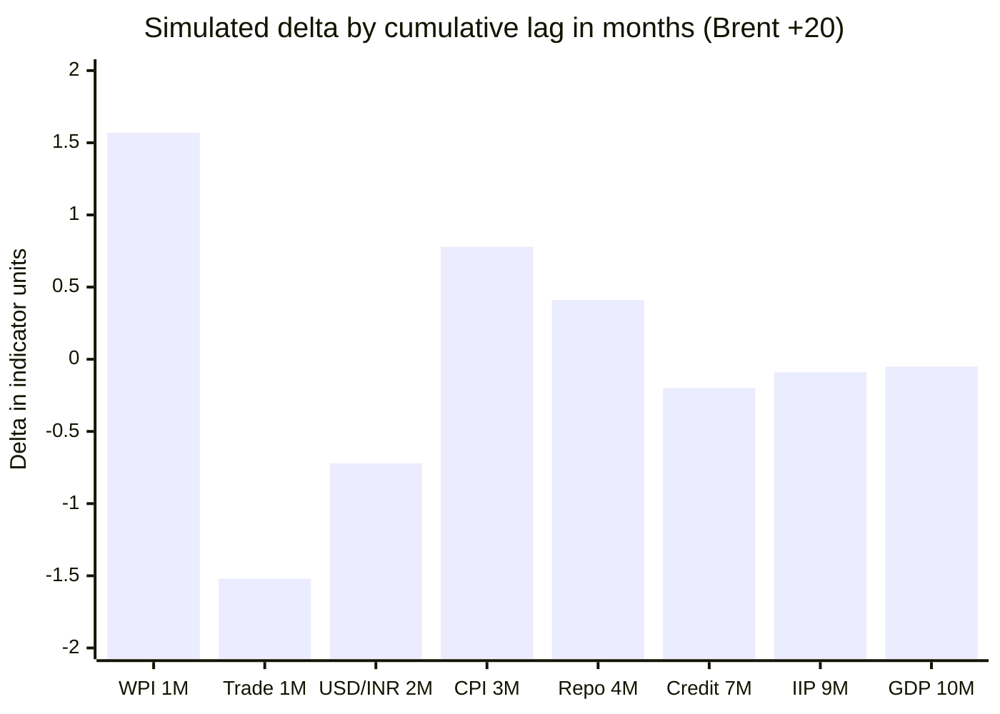

---

## Figure 6.8: Scenario fan: confidence of the path decays with hops

<!-- fig: 6.8 confidence-decay -->

- **Caption:** Figure 6.8: Cumulative confidence of transmission paths from Brent crude by number of hops.
- **Use in:** 6.6 Case study.
- **Description:** Cumulative confidence is the product of edge confidences. Values are from the engine run: WPI 0.95 (1 hop), CPI 0.85 (2 hops), repo 0.81, credit 0.71, IIP 0.59, GDP 0.57. It shows why distant effects should be read with more caution, a point worth making in the discussion.

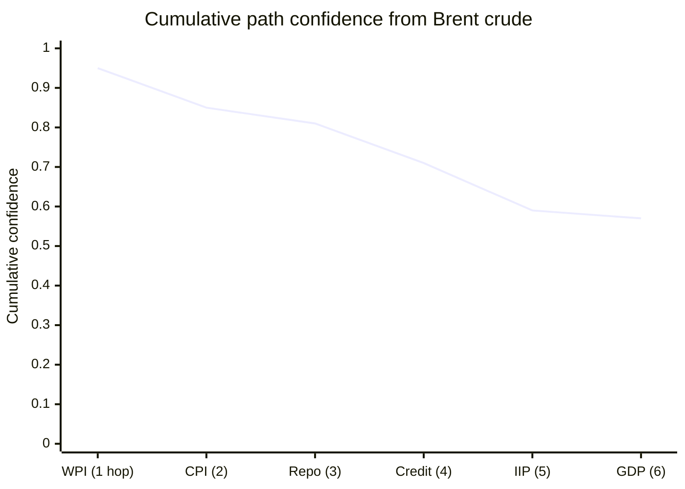

---

## Figure 6.9: Neo4j mirroring

<!-- fig: 6.9 neo4j-sync -->

- **Caption:** Figure 6.9: Optional synchronisation of the ontology to a Neo4j database at gateway start.
- **Use in:** 6.7 Persistence.
- **Description:** Neo4j is disabled unless `NEO4J_URI` is set. The sync is the only write path and is idempotent (MERGE on stable ids), with three retry attempts. NetworkX remains the query engine for the orchestrator.

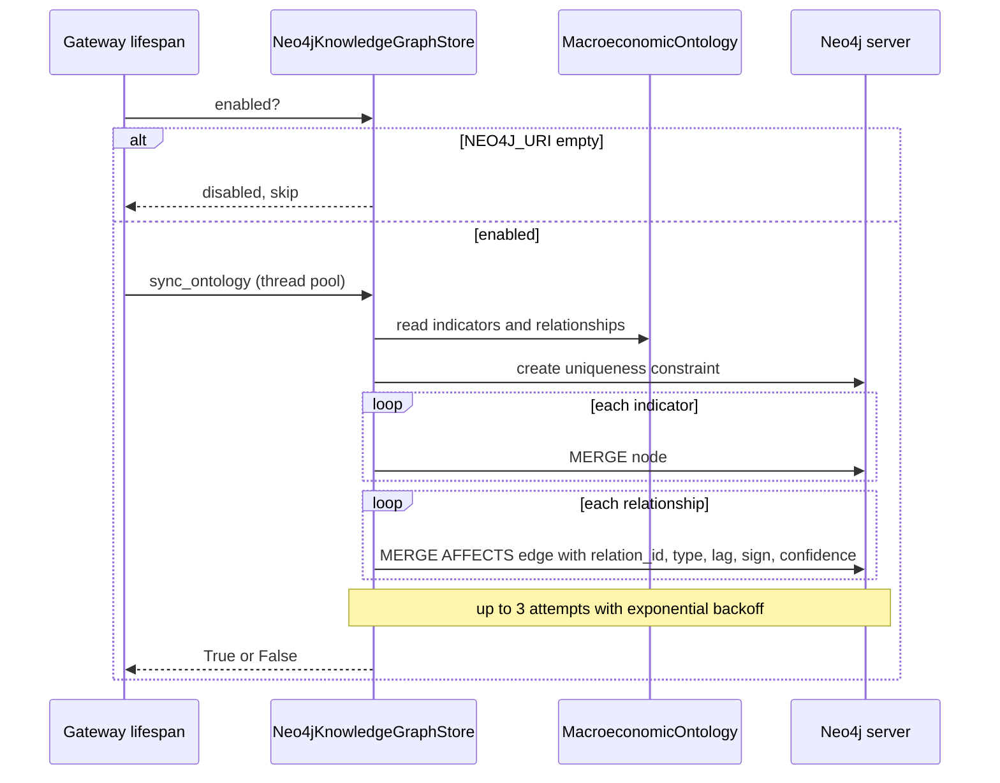

---

## Figure 6.10: Canonical indicator id mapping

<!-- fig: 6.10 canonical-id-mapping -->

- **Caption:** Figure 6.10: Mapping of sector-native indicator names to canonical ontology identifiers.
- **Use in:** 6.8 Integration with sector agents.
- **Description:** Sector agents report observations under their own names. `CANONICAL_ID_MAP` aliases them onto canonical ids so that the orchestrator can join sector evidence to graph nodes. Only canonical nodes can have transmission paths.

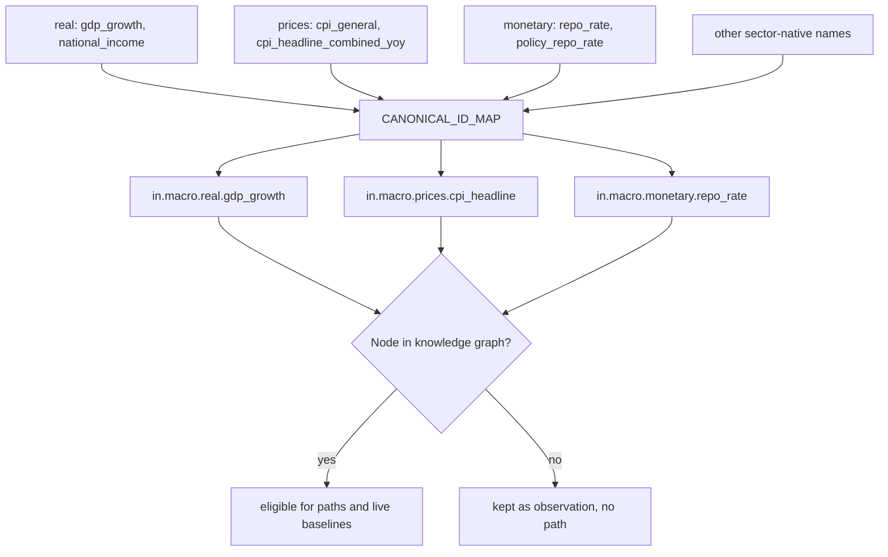

---

## Figure 6.11: Knowledge-graph enrichment node

<!-- fig: 6.11 enrichment-node -->

- **Caption:** Figure 6.11: Operation of the knowledge-graph causal enrichment node.
- **Use in:** 6.8 Integration.
- **Description:** Indicators from collected observations (and the shocked variable) are filtered to KG nodes; all ordered pairs are queried for a path; an optional scenario is simulated; and a Mermaid diagram for the first five nodes is produced for the report.

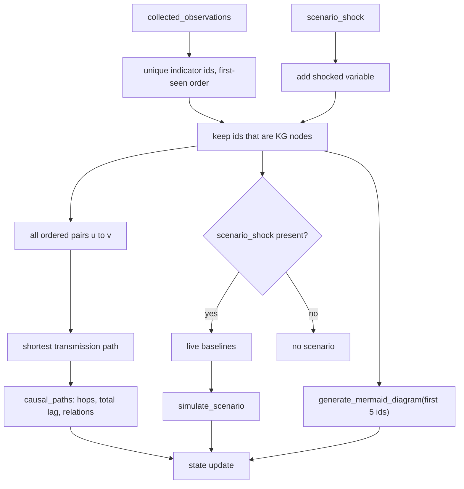
