# Chapter 7: Research Lab, Daily Brief and Claim Verification - Figures

This chapter holds the most original parts of the project. Label every simulated output as simulated in the text; the code does the same (`SIM`, `SIMULATED`, `heuristic`).

---

## Figure 7.1: Research lab architecture

<!-- fig: 7.1 research-lab-overview -->

- **Caption:** Figure 7.1: Research lab modules, API endpoints and user-interface tabs.
- **Use in:** 7.1 Overview.
- **Description:** The research modules are pure functions over the frozen graph, the engine and series already held by the dashboard helpers. They never mutate engine state. Chat adds two of them (consensus and model card) to the final streamed event.

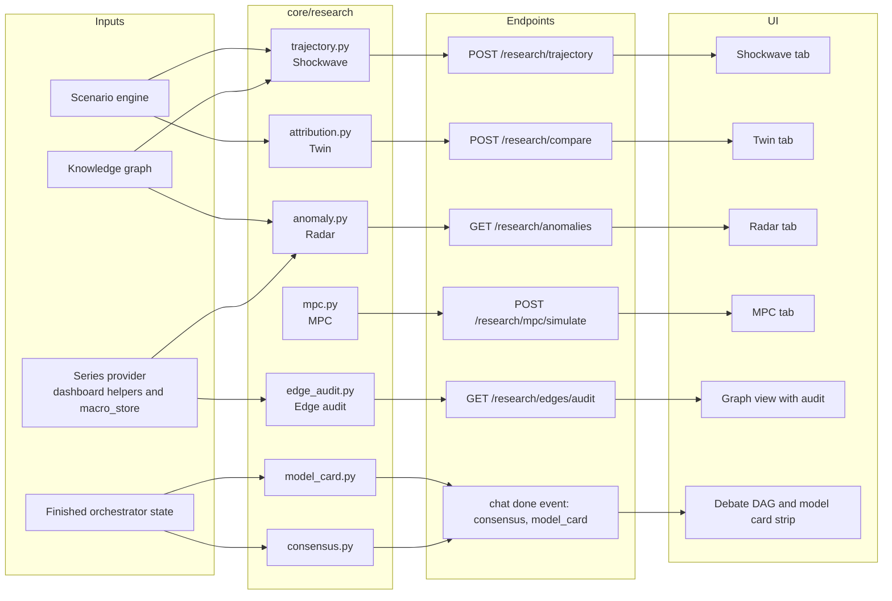

---

## Figure 7.2: Shockwave trajectory construction

<!-- fig: 7.2 shockwave-trajectory -->

- **Caption:** Figure 7.2: Construction of monthly impact trajectories from a single scenario result.
- **Use in:** 7.2 Shockwave.
- **Description:** The engine gives one peak delta and one lag per node. The trajectory keeps the baseline until the lag month, then applies either a step to the peak or an exponential decay with a chosen half-life. The 12-month horizon is adjustable from 1 to 60 months.

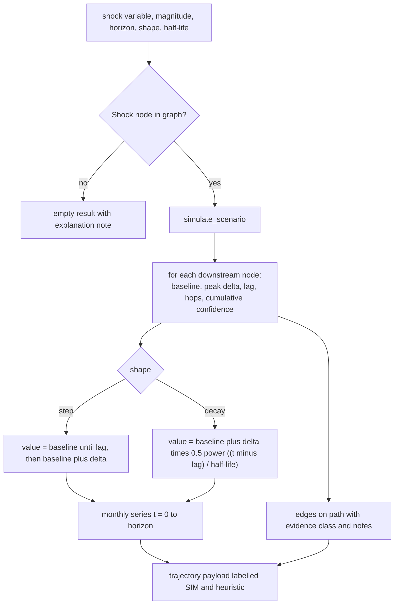

---

## Figure 7.3: Twin: base world versus shocked world with attribution

<!-- fig: 7.3 twin-attribution -->

- **Caption:** Figure 7.3: Comparison of the baseline and shocked worlds and per-hop attribution.
- **Use in:** 7.3 Twin.
- **Description:** Two simulations (shock 0 and shock s) give per-node deltas. For each target the path is split into hops and each hop receives a share proportional to the log of its attenuation factor, which identifies the weakest link. Sign flips (inverse edges) are counted.

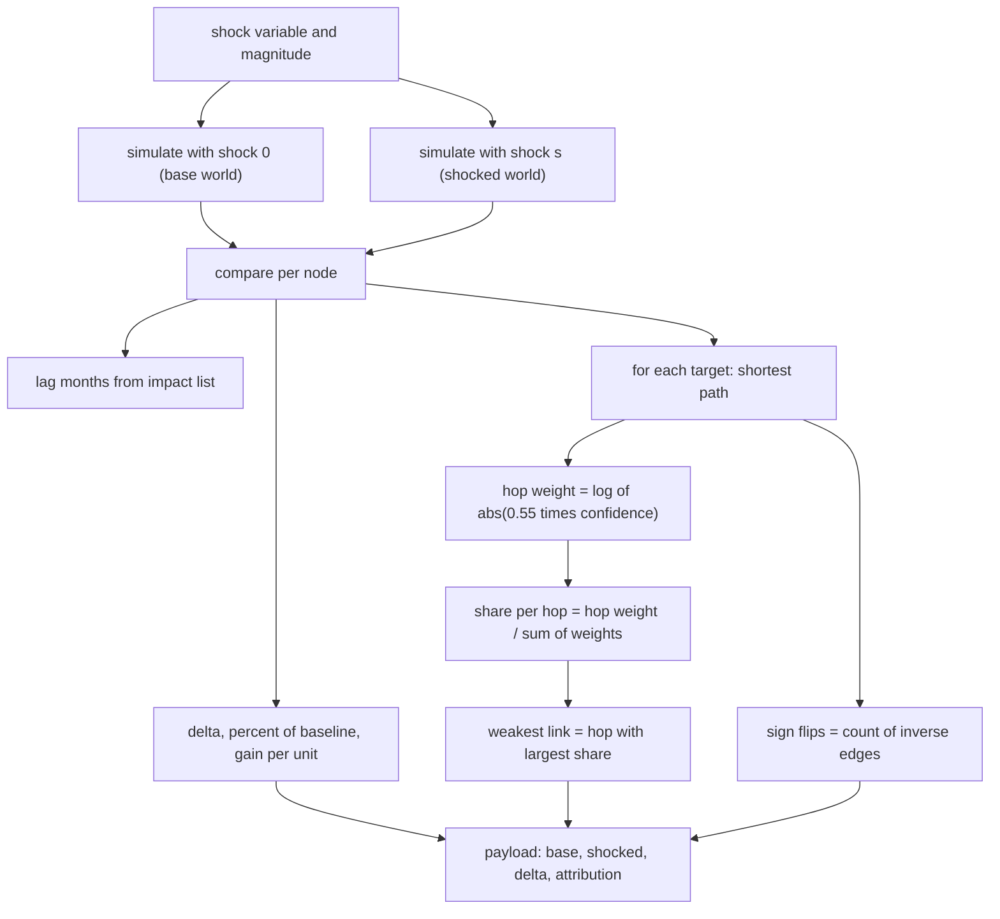

---

## Figure 7.4: Anomaly radar classification

<!-- fig: 7.4 anomaly-radar -->

- **Caption:** Figure 7.4: Rolling z-score anomaly detection classified against the causal graph.
- **Use in:** 7.4 Anomaly Radar.
- **Description:** The latest point is compared with the trailing 12 observations (the latest point is excluded from its own baseline). Anomalies above |z| of 2.0 are classified by what their graph neighbours did: PROPAGATING if a linked indicator is also anomalous, ISOLATED if none is, UNLINKED if no neighbour has data. Isolated and unlinked ones are marked for source verification because they may be data errors.

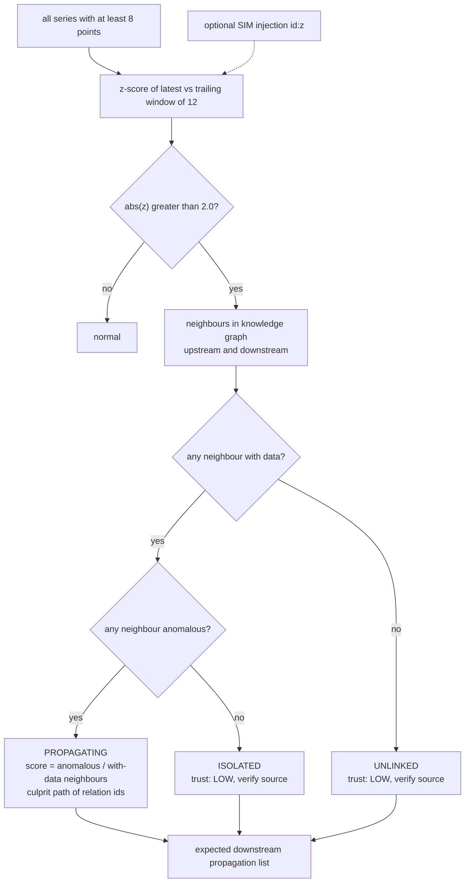

---

## Figure 7.5: Edge evidence audit

<!-- fig: 7.5 edge-audit -->

- **Caption:** Figure 7.5: Edge evidence audit: seeded priors tested against live series.
- **Use in:** 7.5 Edge Evidence Audit. A key novelty figure.
- **Description:** For each graph edge the audit aligns both series by month. With fewer than ten overlapping months the edge stays untestable. Otherwise a bivariate Granger test is run. The result labels each edge SEEDED (typed prior only) or EMPIRICAL (tested). Results are cached for five minutes.

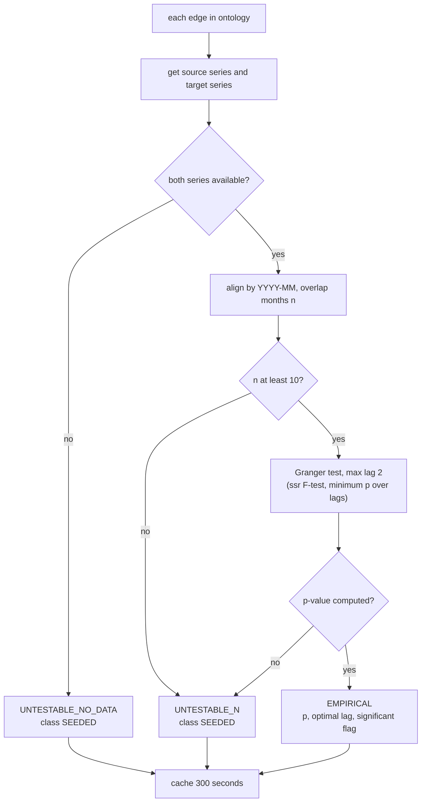

---

## Figure 7.6: Edge evidence states

<!-- fig: 7.6 edge-evidence-states -->

- **Caption:** Figure 7.6: Evidence states of a causal edge and the target path for the project.
- **Use in:** 7.5 Edge Evidence Audit / Chapter 10 future work.
- **Description:** Today an edge is either SEEDED or EMPIRICAL (single Granger test). The dashed future states describe the roadmap: stationarity-checked, multiple-testing-corrected and stability-tested estimates.

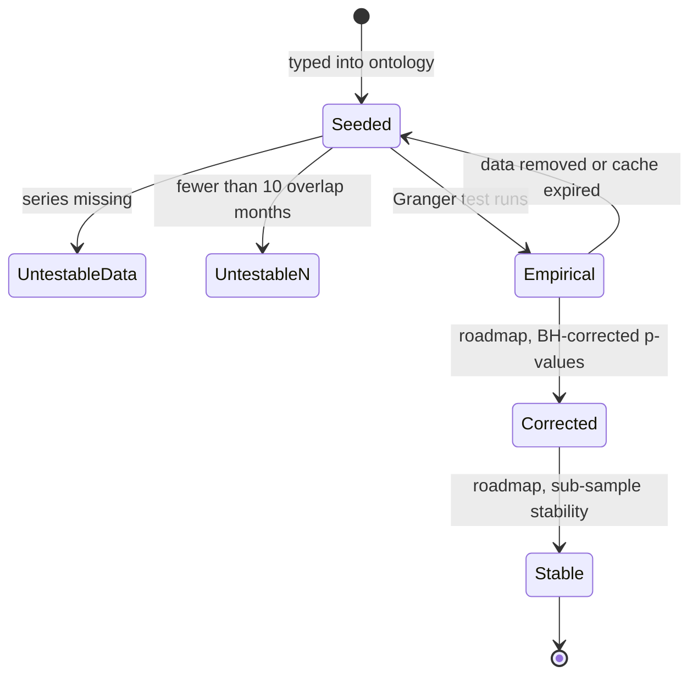

---

## Figure 7.7: Simulated MPC meeting

<!-- fig: 7.7 mpc-simulation -->

- **Caption:** Figure 7.7: Simulation of a six-seat Monetary Policy Committee with a deterministic rule baseline.
- **Use in:** 7.6 MPC simulation. A key novelty figure.
- **Description:** An evidence pack (latest CPI, repo rate, GDP growth, USD/INR, credit growth) feeds three persona types (hawk, dove, centrist). Each persona has a rule-based vote and, when an LLM key exists, an LLM vote that must quote a number and cite an indicator from the pack. Six seats map to the three personas. The Governor casts the vote on a tie. The rule-only decision is always reported next to the final one, which makes an ablation possible. The meeting is always labelled SIMULATED.

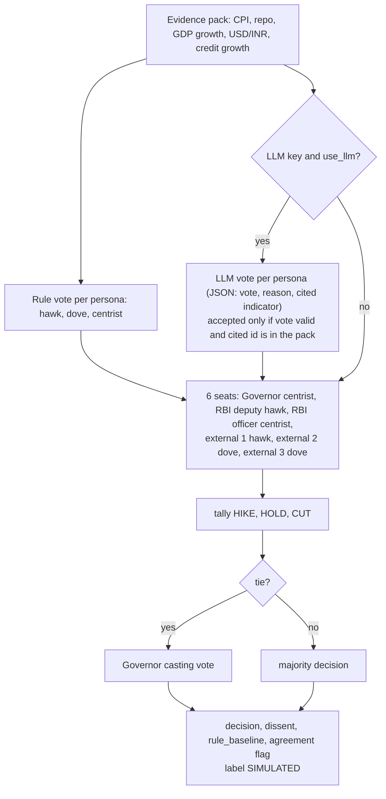

---

## Figure 7.8: MPC rule logic per persona

<!-- fig: 7.8 mpc-rules -->

- **Caption:** Figure 7.8: Deterministic voting rules of the hawk, dove and centrist archetypes.
- **Use in:** 7.6 MPC simulation.
- **Description:** The thresholds 2%, 4% and 6% are the inflation-targeting band of the RBI framework (target 4% with a 2 to 6% tolerance band). `growth_weakening` is true when the latest GDP growth is below the prior value.

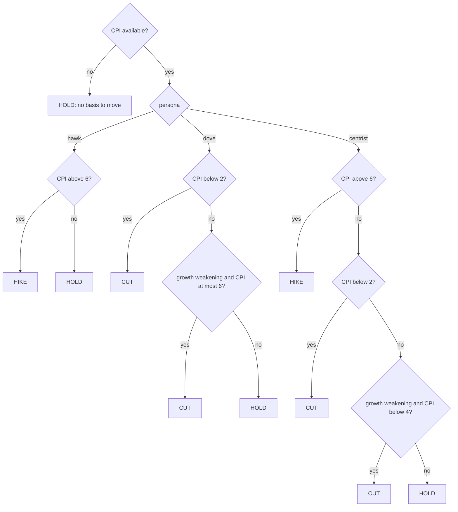

---

## Figure 7.9: Consensus and model-card computation

<!-- fig: 7.9 consensus-model-card -->

- **Caption:** Figure 7.9: Derivation of the heuristic consensus quality and the model card from a finished orchestrator state.
- **Use in:** 7.7 Provenance cards.
- **Description:** Both are labelled heuristic in the payload. The consensus quality multiplies agent success, evidence cover and a knowledge-graph coverage factor. The trust score is the weighted sum 0.4 x evidence cover + 0.3 x mean edge confidence + 0.3 x agent success. The weights are design choices, not calibrated values; say so.

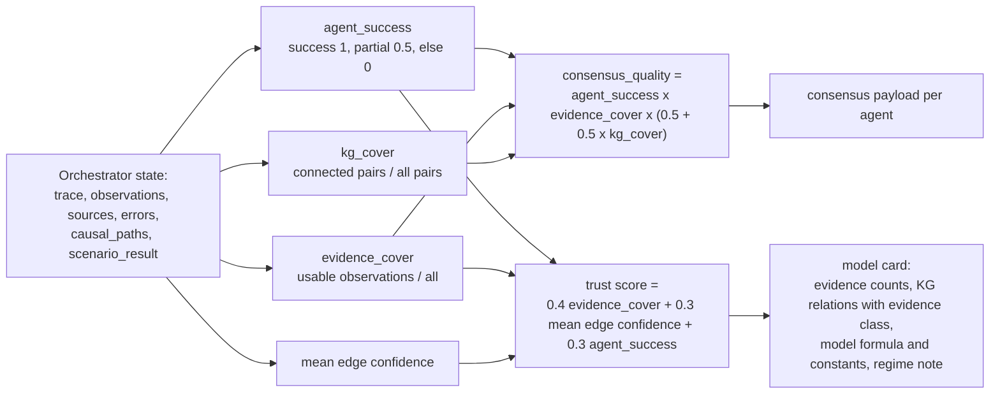

---

## Figure 7.10: Daily early-warning brief pipeline

<!-- fig: 7.10 daily-brief -->

- **Caption:** Figure 7.10: Daily early-warning brief generation with deterministic fallback.
- **Use in:** 7.8 Daily brief.
- **Description:** A single scheduled or on-demand job reads dashboard telemetry (monetary, fiscal, external, markets), runs the anomaly scan, fetches capped and cached news, then makes at most one LLM call. If the LLM is unavailable or returns invalid JSON, a deterministic template is used. The brief is stored by Asia/Kolkata date.

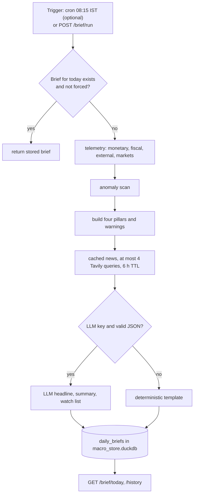

---

## Figure 7.11: Claim verification pipeline

<!-- fig: 7.11 claim-verification-pipeline -->

- **Caption:** Figure 7.11: Claim verification pipeline: from retrieved evidence and proposed claims to rendered text and audit record.
- **Use in:** 7.9 Claim verification. The strongest novelty figure.
- **Description:** Observations and source passages are frozen into content-addressed evidence. Claims proposed by rules or a model must match a strict schema. Numeric claims are recomputed with Decimal arithmetic; qualitative claims are verified as exact source sentences or reviewed templates. Only controlled text is rendered; everything is written to an append-only audit. Be explicit that the pipeline is currently a tested library not yet connected to the answer path.

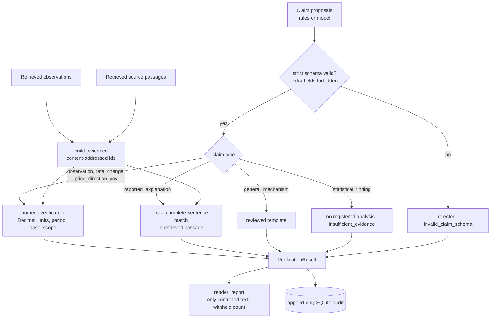

---

## Figure 7.12: Verification status outcomes

<!-- fig: 7.12 verification-statuses -->

- **Caption:** Figure 7.12: Possible outcomes of verifying a claim and what each guarantees.
- **Use in:** 7.9 Claim verification.
- **Description:** `verified` is a statement about consistency with the retrieved snapshot, not about the correctness of the provider. `source_attributed` shows an exact quotation without certifying causation.

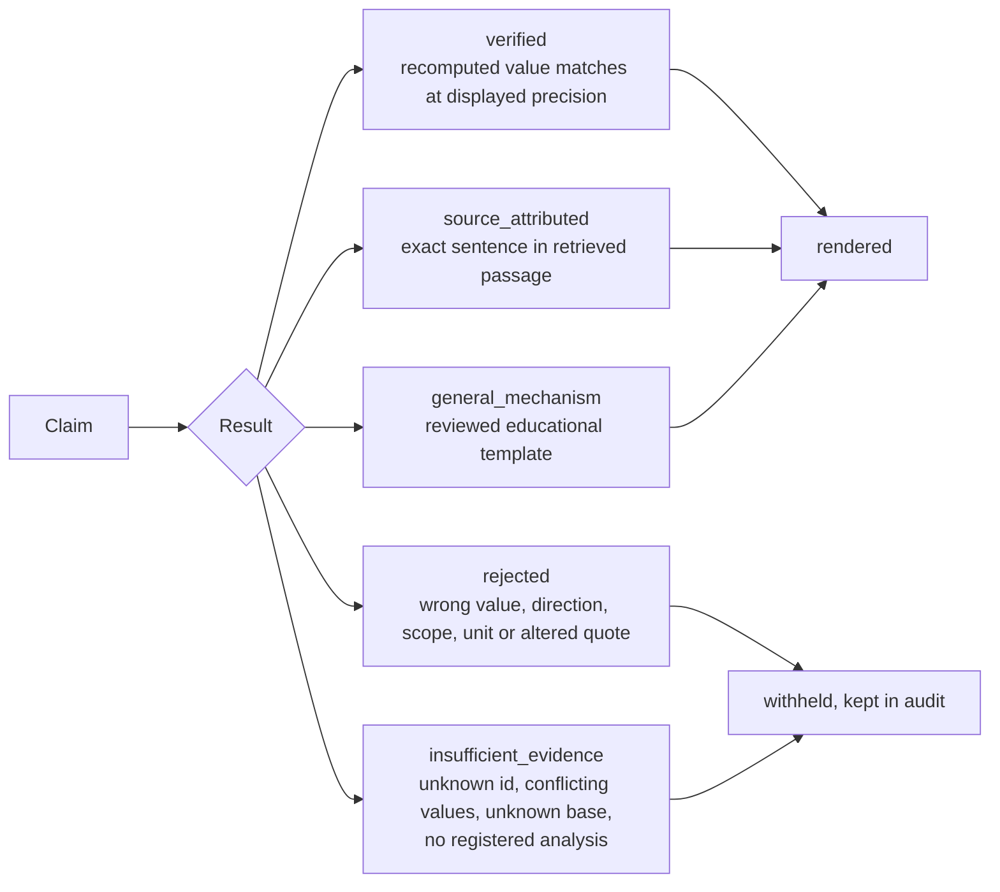

---

## Figure 7.13: Claim type model

<!-- fig: 7.13 claim-class-diagram -->

- **Caption:** Figure 7.13: Discriminated union of claim types accepted by the verifier.
- **Use in:** 7.9 Claim verification.
- **Description:** All claim classes forbid extra fields. A model cannot introduce a new claim type, formula or free text; this is the design decision that prevents prose from becoming fact.

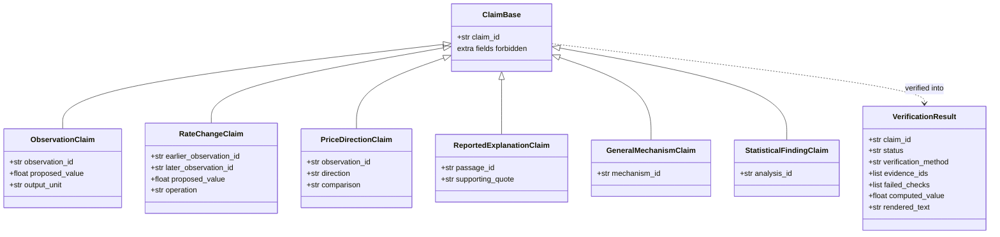

---

## Figure 7.14: Content-addressed evidence identity

<!-- fig: 7.14 evidence-identity -->

- **Caption:** Figure 7.14: Identity rules for evidence records: revisions change the id, retrieval time does not.
- **Use in:** 7.9 Claim verification.
- **Description:** The id is a SHA-256 of the canonical JSON of the record without volatile fields. Two retrievals of the same published value share an id; a revised value or changed definition gets a new id, so an audit can show which version supported an answer.

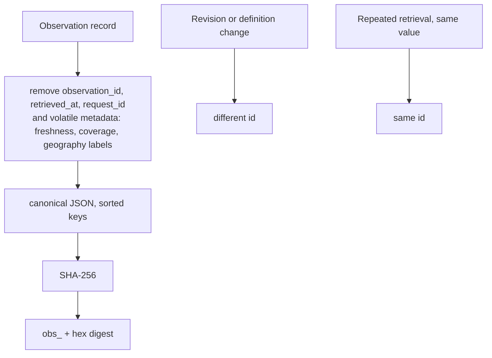

---

## Figure 7.15: Proposed verification gate in the orchestrator (future work)

<!-- fig: 7.15 proposed-verification-gate -->

- **Caption:** Figure 7.15: Proposed integration of the claim verifier into orchestrator synthesis (not yet implemented).
- **Use in:** Chapter 10 Future work (and 7.9 as the design target).
- **Description:** In the current system the LLM narrative is rendered as written. In the proposed design the LLM returns structured claims and a template id; the verifier checks them against the A2A evidence; only verified statements are rendered, and causal claims are hedged by the evidence class of the edge they rely on. This is the main planned research contribution.

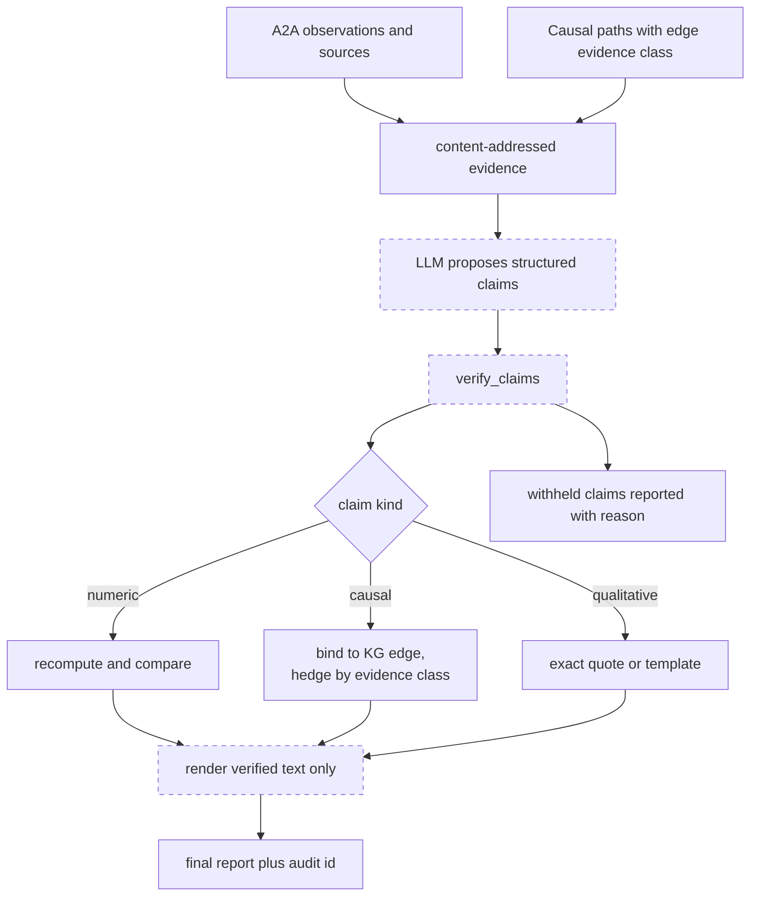
