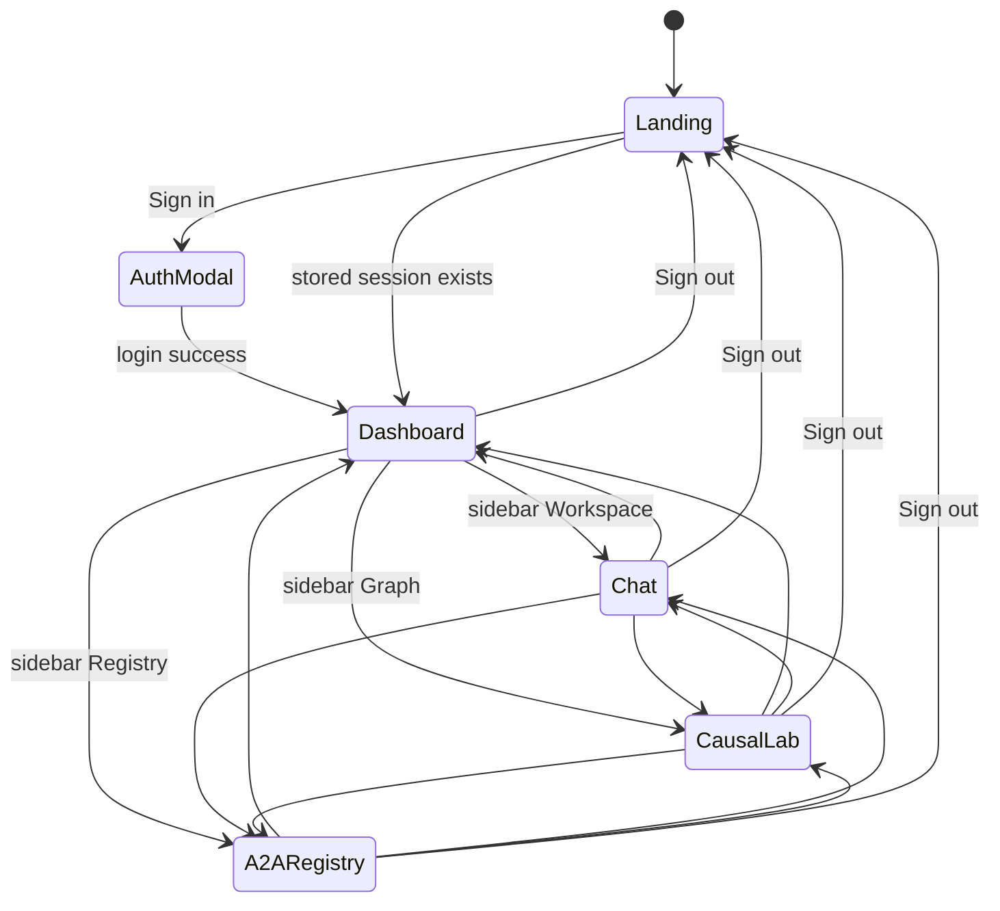
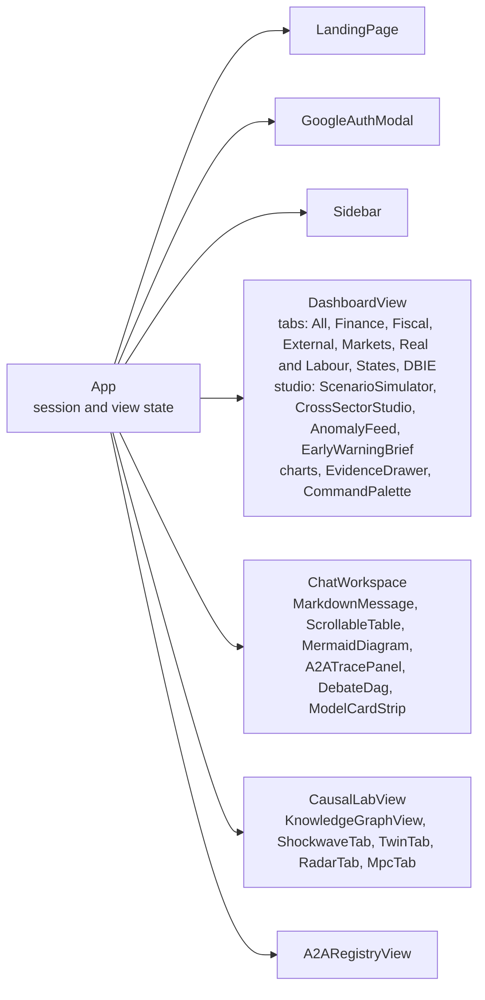
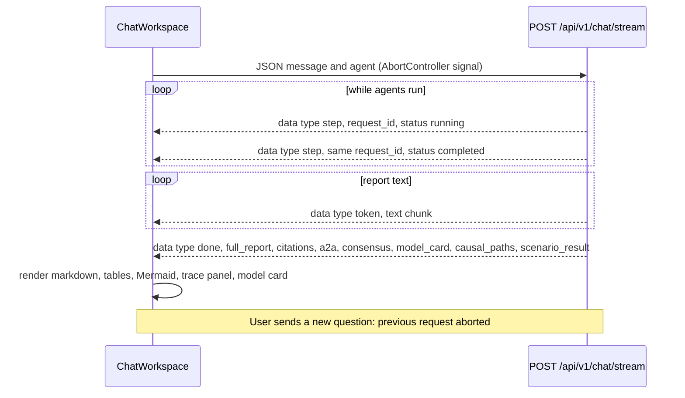
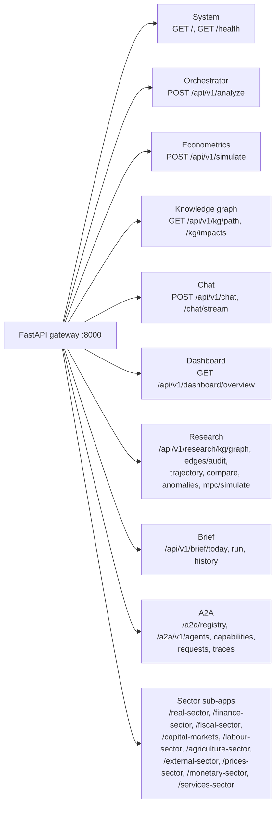
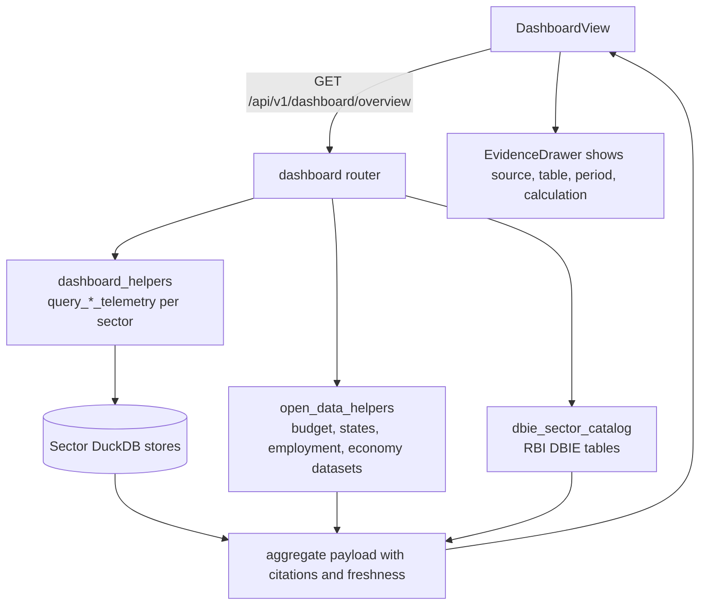
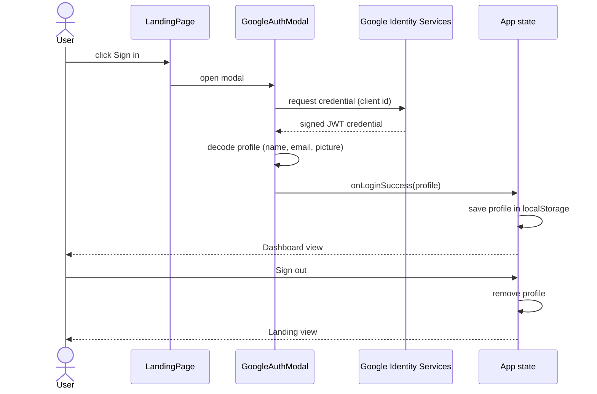
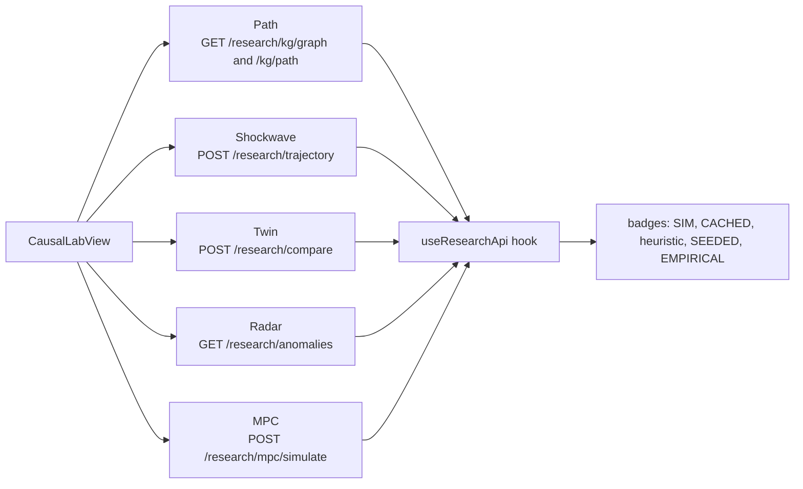
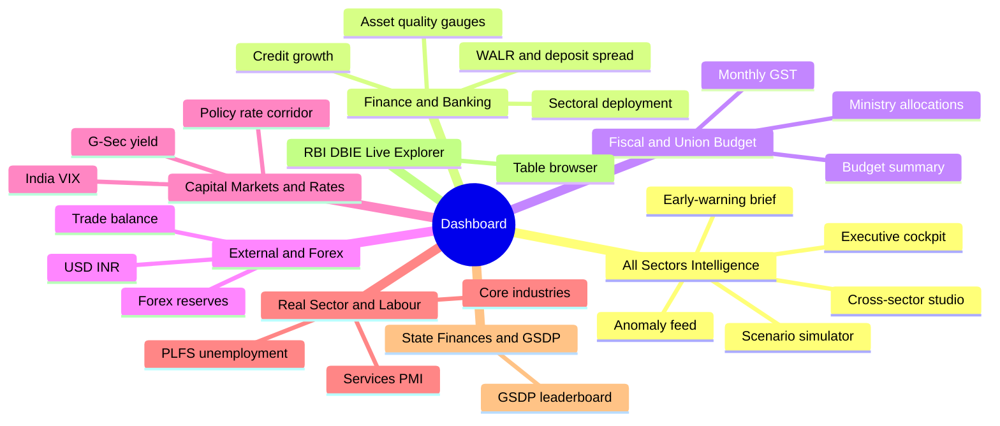

# Chapter 8: User Interface and API - Figures

Besides the diagrams, this chapter needs real screenshots. A capture checklist is at the end of this file (Figures 8.9 to 8.18). Take screenshots at 1440 x 900 in the dark theme, crop the browser chrome, and save as PNG into `docs/images/screenshots/`.

---

## Figure 8.1: Frontend navigation state machine

<!-- fig: 8.1 ui-navigation -->

- **Caption:** Figure 8.1: Top-level views of the web application and the transitions between them.
- **Use in:** 8.1 Frontend architecture.
- **Description:** An unauthenticated visitor sees the landing page. After Google sign-in (or restored session from local storage) the sidebar switches among four workspace views. Sign-out clears the stored profile and returns to the landing page.

---

## Figure 8.2: Frontend component hierarchy

<!-- fig: 8.2 component-hierarchy -->

- **Caption:** Figure 8.2: React component hierarchy of the application.
- **Use in:** 8.1 Frontend architecture.
- **Description:** `App` owns session and view state. The dashboard is split into eight tabs, the chat workspace renders streaming markdown, tables and Mermaid, and the Causal Lab is a tab shell around the knowledge-graph view and the four research tabs.

---

## Figure 8.3: Streaming chat protocol (SSE)

<!-- fig: 8.3 sse-protocol -->

- **Caption:** Figure 8.3: Server-Sent Events protocol between the chat workspace and the gateway.
- **Use in:** 8.3 Chat interface.
- **Description:** The browser reads the response stream with `fetch` and an `AbortController` so a new question cancels the previous one. Event types are `step` (agent or tool progress, updated in place by `request_id`), `token` (report text chunks) and `done` (final payload).

---

## Figure 8.4: API surface map

<!-- fig: 8.4 api-map -->

- **Caption:** Figure 8.4: HTTP API surface of the gateway grouped by router.
- **Use in:** 8.2 Backend API design.
- **Description:** One box per router. Sector sub-apps are mounted under their own prefix and expose data endpoints for their own domain. The research and brief routers are loaded in a guarded block so a failure there cannot stop the gateway.

---

## Figure 8.5: Dashboard data flow

<!-- fig: 8.5 dashboard-dataflow -->

- **Caption:** Figure 8.5: Data flow of the dashboard overview endpoint.
- **Use in:** 8.4 Dashboard.
- **Description:** The overview endpoint aggregates sector telemetry from DuckDB stores plus open datasets and the RBI DBIE explorer. Each indicator keeps its citation so the UI can open the evidence drawer.

---

## Figure 8.6: Authentication and session flow

<!-- fig: 8.6 auth-flow -->

- **Caption:** Figure 8.6: Google sign-in and local session handling.
- **Use in:** 8.5 Authentication.
- **Description:** The client id comes from `VITE_GOOGLE_CLIENT_ID` or from the sign-in modal. The decoded profile is stored in the browser's local storage; there is no server-side session, so the gateway endpoints themselves are not protected (listed as a limitation in Chapter 9).

---

## Figure 8.7: Causal Lab tab structure

<!-- fig: 8.7 causal-lab-tabs -->

- **Caption:** Figure 8.7: The Causal Lab workspace and the backend endpoint behind each tab.
- **Use in:** 8.6 Causal Lab.
- **Description:** Five tabs share a data hook (`useResearchApi`) that calls the research endpoints; every response carries labels so the UI can show SIM, CACHED and heuristic badges.

---

## Figure 8.8: Dashboard tab map

<!-- fig: 8.8 dashboard-tabs -->

- **Caption:** Figure 8.8: Dashboard tabs and the sectors that feed each of them.
- **Use in:** 8.4 Dashboard.
- **Description:** Eight tabs. The first combines cross-sector studio widgets; the last is a live explorer for RBI DBIE tables.

---

## Screenshot checklist (Figures 8.9 to 8.18)

Capture each of the following from the running application. Use this table directly as the figure list. Filename pattern: `fig-8-N-name.png`.

| Figure | Screen to capture | Notes |
| :-- | :-- | :-- |
| 8.9 | Landing page | Hero and feature cards |
| 8.10 | Google sign-in modal | Hide any real client id |
| 8.11 | Dashboard, All Sectors tab | Show KPI cards and a chart |
| 8.12 | Dashboard, Finance tab | Gauges and spread chart |
| 8.13 | Evidence drawer open on one KPI | Shows source, table, period |
| 8.14 | Chat workspace mid-stream | Step cards visible |
| 8.15 | Chat final report with Mermaid causal diagram and tables | Scroll so diagram and indicator matrix are visible |
| 8.16 | A2A trace panel for one run | Request tree, timings |
| 8.17 | A2A registry view | Agent cards and dependency edges |
| 8.18 | Causal Lab: one screenshot each of Path, Shockwave, Twin, Radar, MPC (name them 8.18a to 8.18e) | MPC must show the SIMULATED label |
