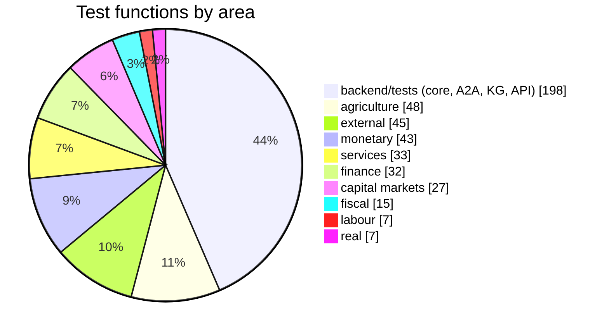
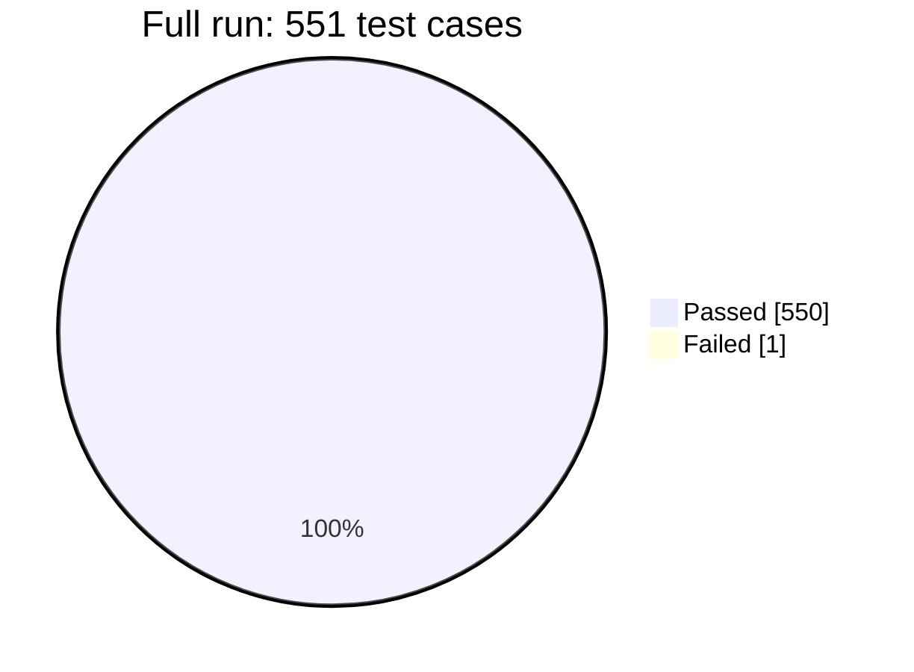
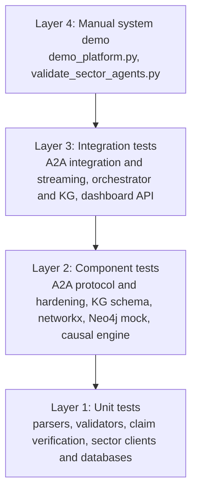
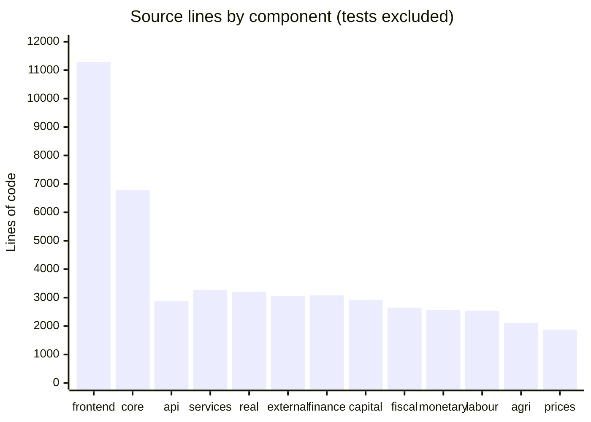
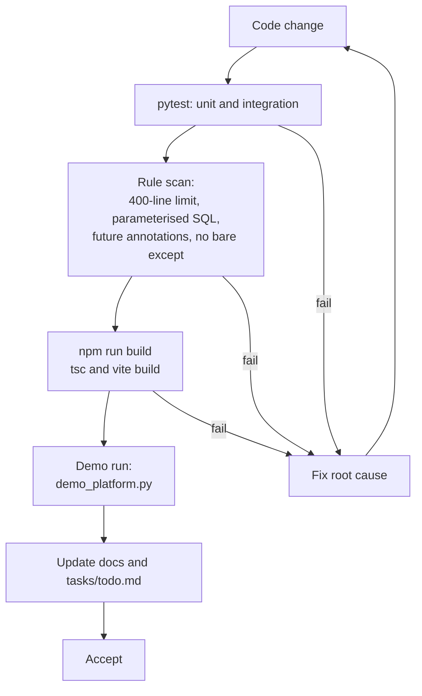
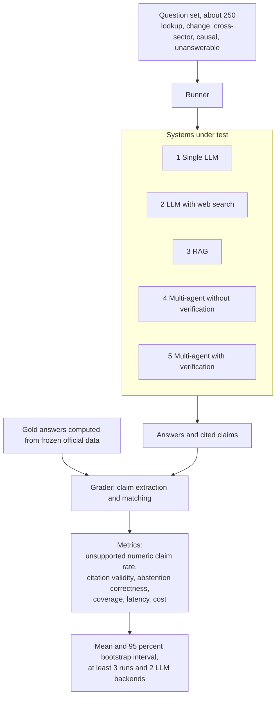
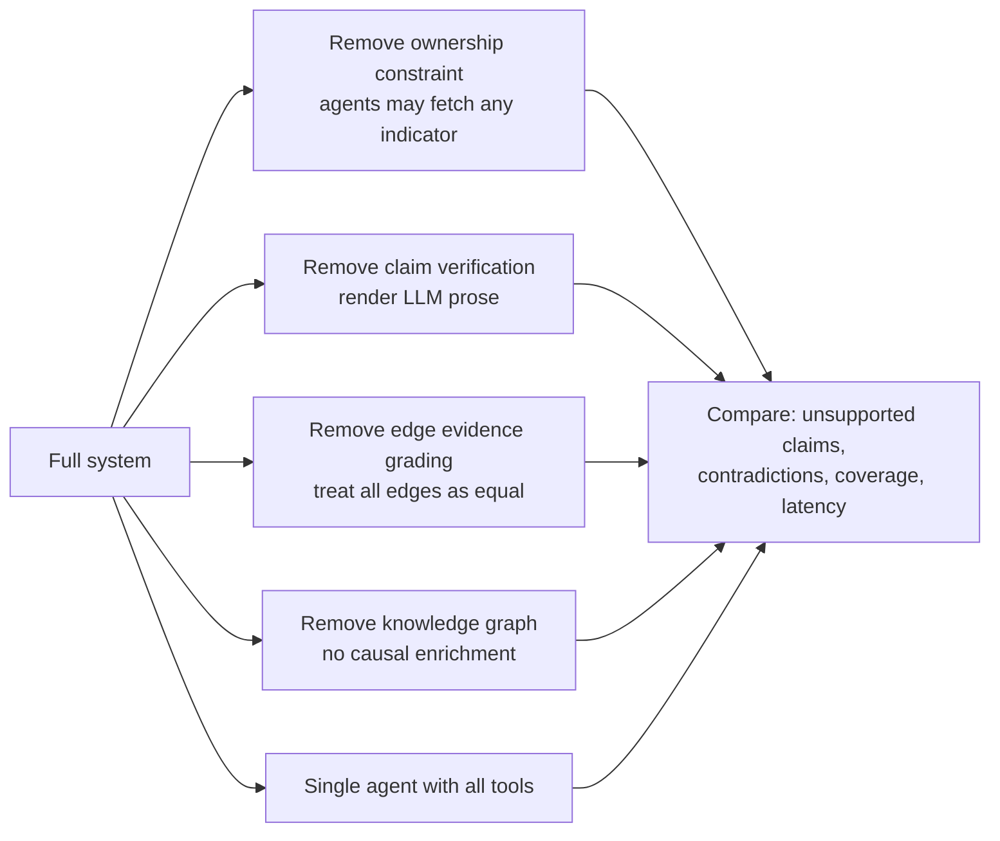
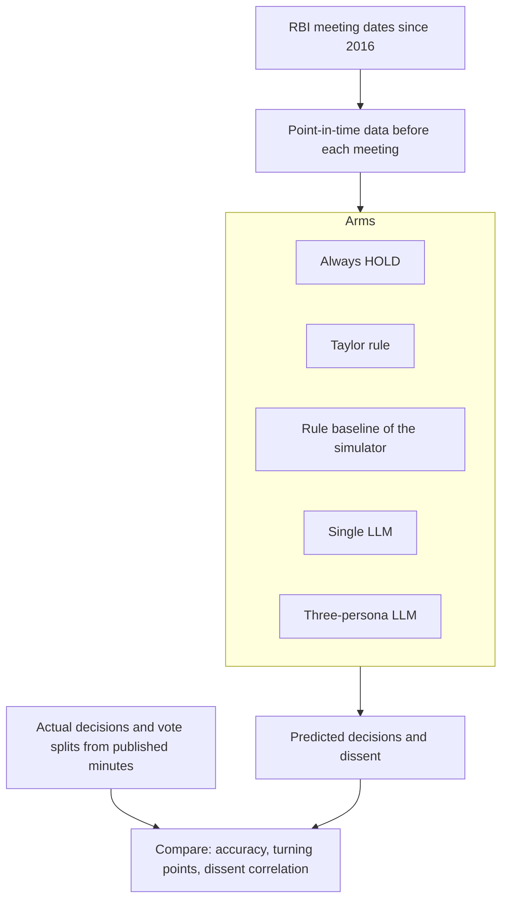
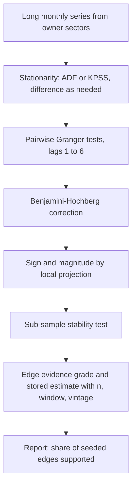
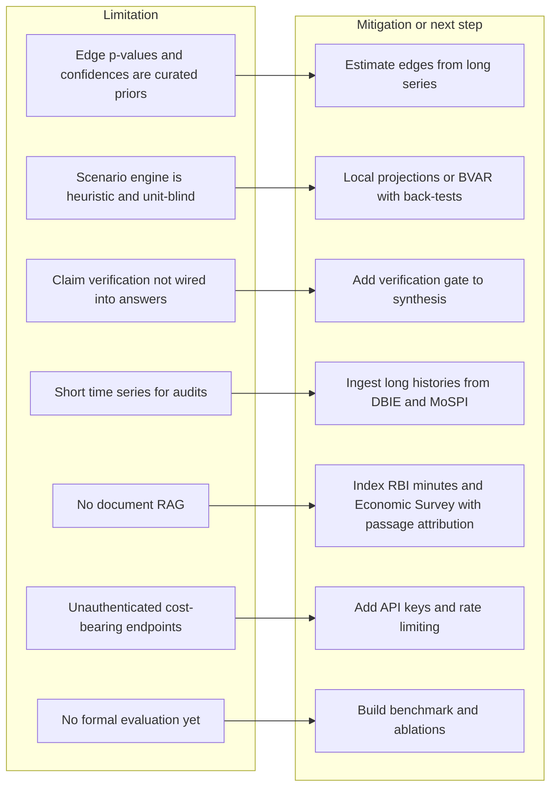

# Chapter 9: Testing, Results and Evaluation - Figures

Measured values below were collected on 2026-10-12 from the repository (test function counts by `grep`, line counts by `wc`, full test run). Update them if the code changes before submission. The evaluation-design figures (9.6 to 9.9) describe planned work; do not present them as results.

---

## Figure 9.1: Test suite composition by area

<!-- fig: 9.1 test-composition -->

- **Caption:** Figure 9.1: Number of test functions per test area (455 functions counted; 551 test cases executed after parametrisation).
- **Use in:** 9.1 Testing strategy.
- **Description:** The core and cross-cutting suite in `backend/tests` is the largest block (A2A protocol and hardening, orchestrator integration, knowledge graph, causal engine, claim verification, dashboard, prices and real sector). Sector suites follow.

---

## Figure 9.2: Result of the full test run

<!-- fig: 9.2 test-results -->

- **Caption:** Figure 9.2: Outcome of the complete backend test run on 12 October 2026.
- **Use in:** 9.2 Test results.
- **Description:** 550 passed and 1 failed in 715 seconds. The failure is a monetary-sector test whose stub no longer reaches the fallback path (expected repo rate 5.0, got 5.25). Fix it or report it as a known issue; do not hide it.

---

## Figure 9.3: Test pyramid of the project

<!-- fig: 9.3 test-pyramid -->

- **Caption:** Figure 9.3: Layers of testing applied to the platform.
- **Use in:** 9.1 Testing strategy.
- **Description:** Unit tests dominate. Protocol and orchestrator integration tests use stub handlers and a mocked LLM. The Chapter 9 limitation applies: there are no browser end-to-end tests and no frontend unit tests; `npm run build` is the only frontend check.

---

## Figure 9.4: Source code size by component

<!-- fig: 9.4 code-size -->

- **Caption:** Figure 9.4: Non-test source lines by component.
- **Use in:** 9.3 Implementation statistics.
- **Description:** Lines of Python (backend) and TypeScript (frontend), tests excluded. The core package and the frontend are the largest items; each sector is between about 1.9k and 3.3k lines.

---

## Figure 9.5: Quality gates and verification workflow

<!-- fig: 9.5 quality-gates -->

- **Caption:** Figure 9.5: Verification workflow followed before a change is accepted.
- **Use in:** 9.1 Testing strategy.
- **Description:** The gates mirror the project's agent contract (`.agents/AGENTS.md`). Add continuous integration (not present today) to run the full-suite gate automatically.

---

## Figure 9.6: Proposed evaluation harness (planned)

<!-- fig: 9.6 evaluation-harness -->

- **Caption:** Figure 9.6: Proposed evaluation harness for measuring unsupported-claim rate and abstention correctness.
- **Use in:** 9.5 Evaluation methodology (planned) or Chapter 10 future work.
- **Description:** Questions have gold answers computed directly from official series, never from model output. Each system answers the same questions; a grader extracts claims and scores them. Results are reported with bootstrap intervals over repeated runs.

---

## Figure 9.7: Ablation design (planned)

<!-- fig: 9.7 ablation-design -->

- **Caption:** Figure 9.7: Planned ablations isolating the contribution of each mechanism.
- **Use in:** 9.5 Evaluation methodology (planned).
- **Description:** Each ablation removes exactly one mechanism from the full system and measures the change in unsupported-claim rate and coverage.

---

## Figure 9.8: Planned MPC benchmark

<!-- fig: 9.8 mpc-benchmark -->

- **Caption:** Figure 9.8: Planned benchmark of the simulated MPC against actual RBI decisions with point-in-time data.
- **Use in:** Chapter 10 future work or 9.5.
- **Description:** The current evidence pack uses the latest values, so it cannot be tested historically without look-ahead leakage. The benchmark needs vintage data available before each meeting date.

---

## Figure 9.9: Edge-audit evaluation plan

<!-- fig: 9.9 edge-audit-plan -->

- **Caption:** Figure 9.9: Planned procedure for estimating causal-edge statistics from data.
- **Use in:** Chapter 10 future work.
- **Description:** Replaces hand-typed p-values and confidences with estimates that carry sample size and stability. Reports what share of seeded edges survives testing.

---

## Figure 9.10: Limitations and risk map

<!-- fig: 9.10 limitations -->

- **Caption:** Figure 9.10: Known limitations of the current implementation and their mitigation.
- **Use in:** 9.6 Limitations / 10.2 Limitations.
- **Description:** State these openly. They come from the code review in `docs/status-and-roadmap.md`.

