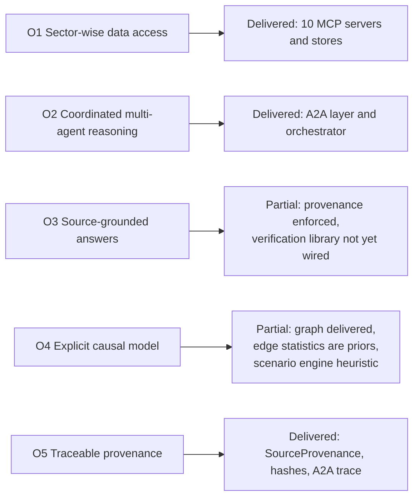
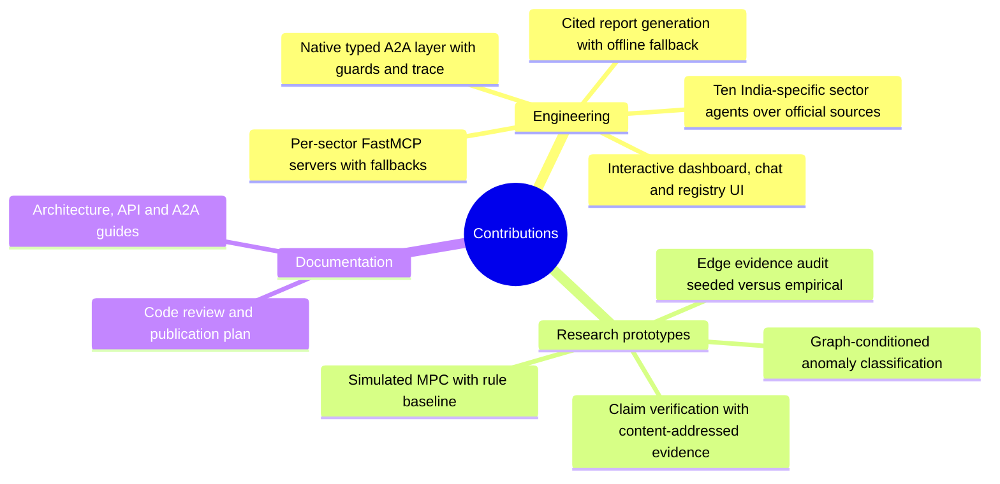
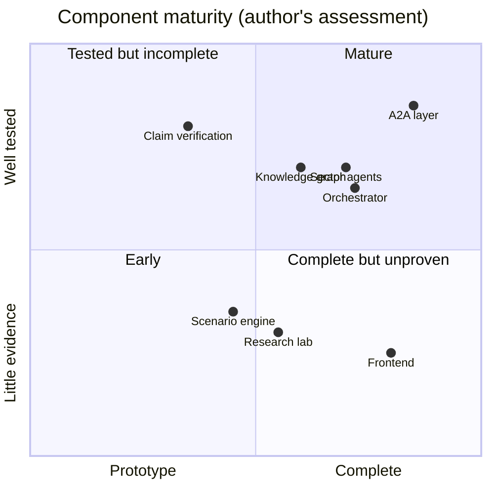
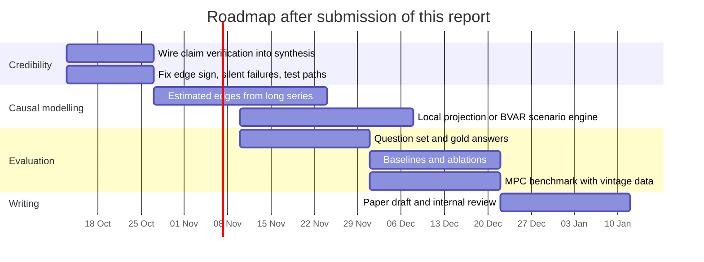
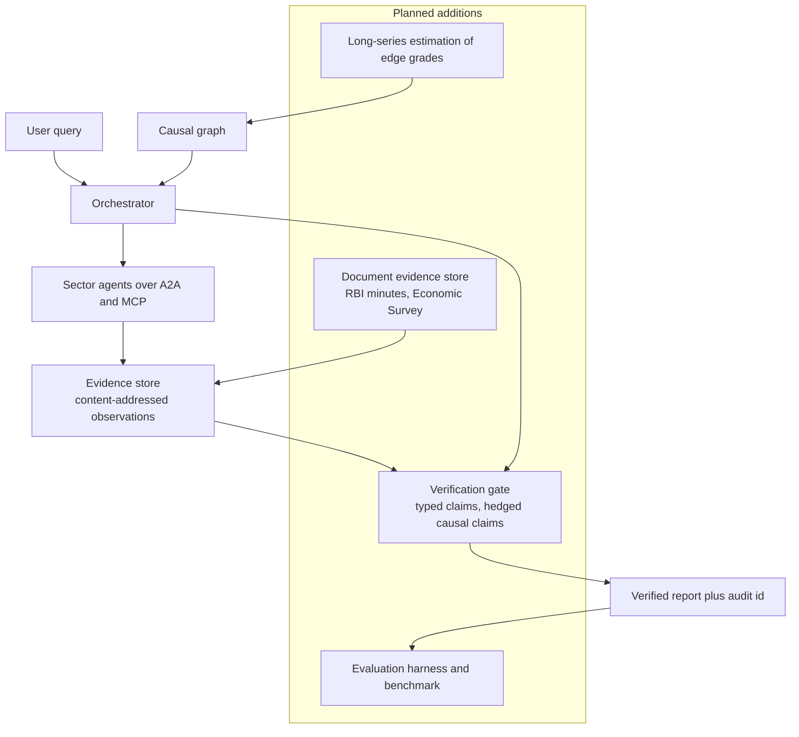
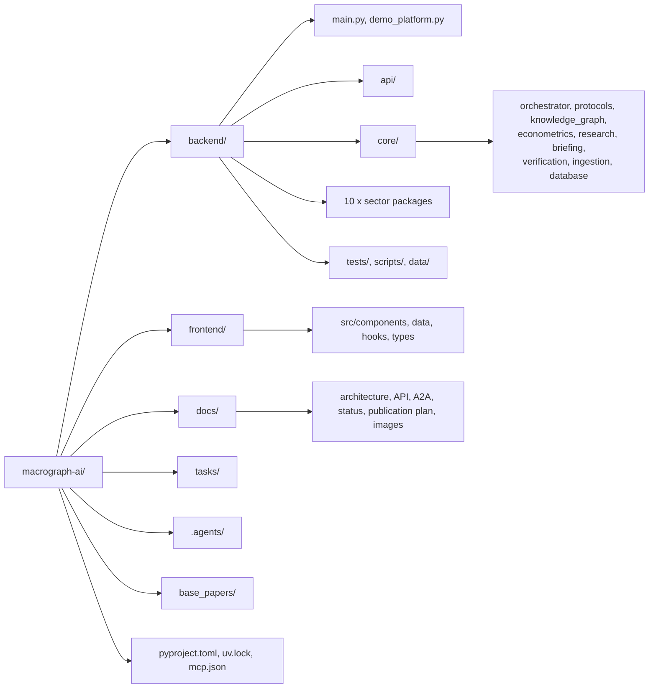
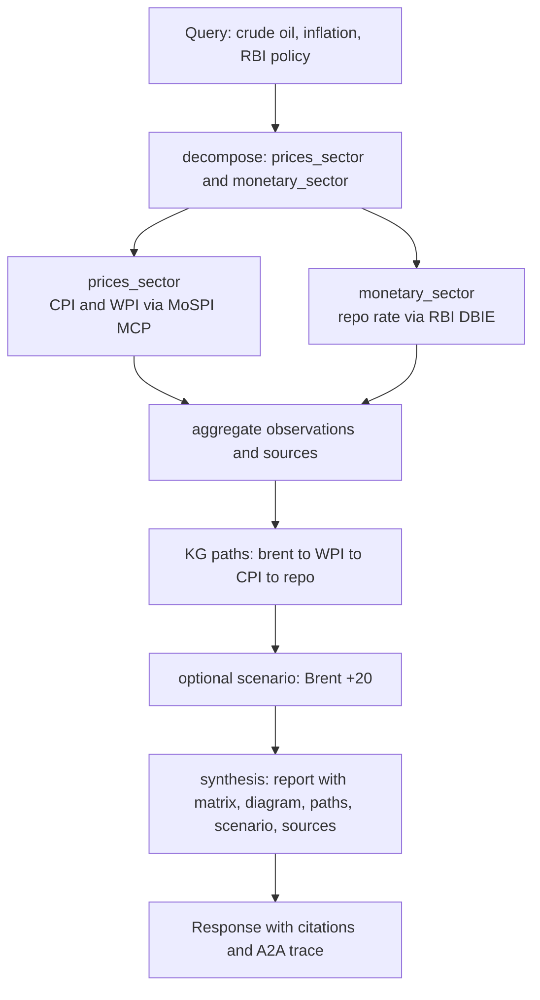
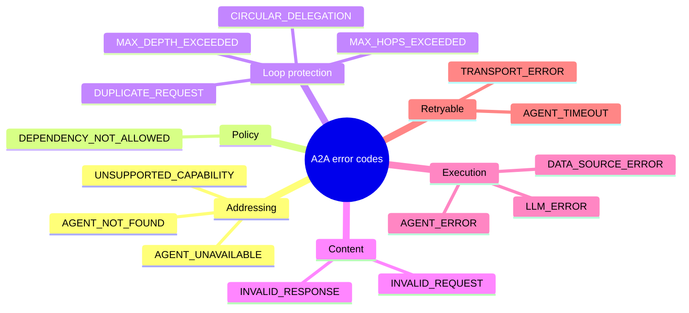

# Chapter 10 and Appendices: Conclusion, Future Work and Supporting Figures

---

## Figure 10.1: Objectives achieved

<!-- fig: 10.1 objectives-achieved -->

- **Caption:** Figure 10.1: Status of the project objectives defined in Chapter 1.
- **Use in:** 10.1 Summary of work.
- **Description:** Traces the five objectives from Figure 1.2 to their delivered status. Fully, Partially and Not yet are honest assessments from the code review.

---

## Figure 10.2: Contributions of the work

<!-- fig: 10.2 contributions -->

- **Caption:** Figure 10.2: Summary of contributions.
- **Use in:** 10.1 Summary / 10.2 Contributions.
- **Description:** Engineering contributions are complete; research contributions are prototypes whose evaluation is future work.

---

## Figure 10.3: Maturity of components

<!-- fig: 10.3 maturity -->

- **Caption:** Figure 10.3: Maturity assessment of the major components (author's assessment from the code review).
- **Use in:** 10.2 Limitations.
- **Description:** Position reflects implementation completeness (x) and evidence of correctness through tests or evaluation (y). Qualitative; explain in the text.

---

## Figure 10.4: Future-work roadmap

<!-- fig: 10.4 roadmap -->

- **Caption:** Figure 10.4: Proposed roadmap for future work (about twelve weeks).
- **Use in:** 10.3 Future work.
- **Description:** Mirrors `docs/publication-plan.md`. Adjust dates to your own plan.

---

## Figure 10.5: Target architecture with the verification gate

<!-- fig: 10.5 target-architecture -->

- **Caption:** Figure 10.5: Target architecture after planned improvements (additions in the dashed group).
- **Use in:** 10.3 Future work.
- **Description:** Compared with Figure 3.2, three additions: a verification gate between synthesis and the report, an evidence-graded graph fed by long series, and a document evidence store for passage-level attribution.

---

## Figure A.1: Repository structure

<!-- fig: A.1 repository-structure -->

- **Caption:** Figure A.1: Repository layout.
- **Use in:** Appendix A.
- **Description:** Top-level folders and their purpose.

---

## Figure A.2: Worked end-to-end example (conceptual)

<!-- fig: A.2 example-query -->

- **Caption:** Figure A.2: Handling of the query "How does a rise in crude oil prices affect inflation and RBI policy?"
- **Use in:** Appendix A or Chapter 5 as a case walkthrough.
- **Description:** Replace the conceptual node text with the actual output (indicator matrix, causal paths and trace) from a real run before printing. The routing shown is what the keyword cards would select for oil, inflation and policy terms.

---

## Figure A.3: Error-code taxonomy

<!-- fig: A.3 error-taxonomy -->

- **Caption:** Figure A.3: Taxonomy of A2A error codes.
- **Use in:** Appendix B.
- **Description:** Grouped by cause. Retryable codes are shown in the last group.

